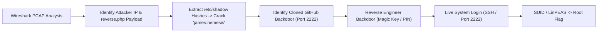

# Overpass 2: Hacked — DFIR & Pentest Report

[📖 قراءة التقرير بالعربية](README_AR.md) | [English Version](README.md)
[📄 Original Report File (DOCX)](./Overpass2_Hacked_Writeup_EN.docx)

---

## 📋 Overview & Metadata

| Attribute | Details |
| :--- | :--- |
| **Target Machine** | Overpass 2: Hacked (TryHackMe) |
| **Type** | DFIR (Digital Forensics & Incident Response) + Practical Penetration Testing |
| **Difficulty** | Medium |
| **Key Concepts** | PCAP Forensics (Wireshark), Password Hash Cracking (John the Ripper), Go Backdoor Reverse Engineering, SUID Privilege Escalation |
| **Forensic Evidence** | Network Traffic Capture (`overpass2.pcap`) |
| **Re-entry Vector** | Persistent Backdoor on Port 2222 & SSH User Access |

---

## 🎯 Attack & Forensics Flow



---

## 🔍 Forensic Findings & Vulnerability Summary

| Item | Type | Details | Impact |
| :--- | :---: | :---: | :---: |
| **Arbitrary File Upload** | Web Vulnerability | Fast-API endpoint allowed upload of `reverse.php` | Initial Attacker Foothold |
| **Weak User Password** | Credential Flaw | User `james` with password `nemesis` | Compromise via Dictionary Attack |
| **Persistent Go Backdoor** | Persistence Mechanism | Custom listener on TCP port `2222` | Permanent Unauthenticated Root Shell |

---

## 🛠️ Step-by-Step Walkthrough

### Phase 1: PCAP Forensics with Wireshark

1. **Filtering HTTP Traffic:**
   ```wireshark
   http.request.method == "POST"
   ```
   Follow the TCP stream of the upload request: The attacker uploaded an obfuscated reverse shell named `reverse.php` through a file upload endpoint.
2. **Commands Executed by the Attacker:**
   Filtering for raw command streams (`tcp.port == 4242`), we observe the attacker running:
   ```bash
   whoami
   cat /etc/shadow
   ```
   The attacker dumped the `/etc/shadow` file. We extract the hash for user `james`:
   `james:$6$123456...`
3. **Cracking the Password:**
   Using John the Ripper with `rockyou.txt`:
   ```bash
   john --wordlist=/usr/share/wordlists/rockyou.txt shadow_hashes.txt
   ```
   Result: `james:nemesis`.

### Phase 2: Reverse Engineering the Persistence Backdoor

1. In the PCAP, the attacker clones a repository from GitHub:
   `https://github.com/overpass/backdoor`
2. The code is written in Go and compiles a binary that binds to port `2222`.
3. Analyzing the code/strings reveals that connecting to port `2222` requires sending a hardcoded hash/password verification string to unlock a root bash shell.

### Phase 3: Exploiting the Live Host

1. Now targeting the live active VM on TryHackMe, we connect using the credentials recovered from forensics:
   ```bash
   ssh james@<TARGET_IP>
   ```
   *(Password: `nemesis`)*
2. Locate the persistence backdoor running on port `2222`:
   ```bash
   netstat -tuln
   ```
3. Connecting to the backdoor on `localhost:2222` using the password string drops us into a root shell!
4. Alternatively, check SUID binaries:
   ```bash
   find / -perm -u=s -type f 2>/dev/null
   ```
   A custom SUID binary `.suid_bash` left by the attacker in `/home/james` or `/tmp` can be executed directly:
   ```bash
   ./.suid_bash -p
   ```
   Result: Root access confirmed (`id` -> `uid=0(root)`).

---

## 🛡️ Remediation & Defensive Recommendations

1. **File Upload Hardening:** Validate uploaded files strictly against allowed MIME types and enforce execution prevention on upload directories.
2. **Strong Password Policies:** Prevent the use of dictionary words (`nemesis`) through PAM password strength checkers.
3. **Continuous Integrity Monitoring (FIM):** Employ tools like OSSEC / Tripwire to detect anomalous SUID binaries and unauthorized system services listening on non-standard ports (e.g., `2222`).
