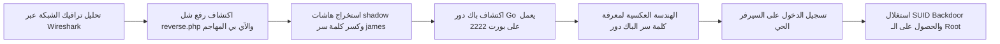

# Overpass 2: Hacked — تقرير التحقيق الجنائي واختبار الاختراق

[English Version](README.md) | [📖 قراءة التقرير بالعربية](README_AR.md)
[📄 تحميل التقرير الأصلي بصيغة DOCX](./Overpass2_Hacked_Writeup_EN.docx)

---

## 📋 بطاقة الهدف والمعلومات العامة

| العنصر | التفاصيل |
| :--- | :--- |
| **اسم الماشين** | Overpass 2: Hacked (منصة TryHackMe) |
| **نوع التحدي** | تحقيق جنائي رقمي (DFIR) + اختبار اختراق عملي |
| **مستوى الصعوبة** | متوسط (Medium) |
| **المفاهيم الأساسية** | تحليل ملفات حزم الشبكة (PCAP)، كسر التشفير، الهندسة العكسية لـ Backdoor، استغلال ملفات SUID |
| **الدليل الجنائي** | ملف التقاط حركة الشبكة (`overpass2.pcap`) |

---

## 🎯 مسار التحليل والهجوم



---

## 🔍 ملخص النتائج الجنائية والثغرات

| العنصر | النوع | التفاصيل | التأثير |
| :--- | :---: | :---: | :---: |
| **رفع ملفات غير مقيد** | ثغرة ويب | رفع شل عكسي `reverse.php` عبر نقطة رفع غير محمية | اختراق السيرفر للمرة الأولى |
| **كلمة مرور مستخدم ضعيفة** | أمان كلمات المرور | كلمة سر المستخدم `james` هي `nemesis` | سهولة كسر الهاش بالمعاجم |
| **باب خلفي مستمر (Backdoor)** | آلية استدامة | سكريبت Go يستمع على المنفذ 2222 | فتح ثغرة دائمة لصلاحيات Root |

---

## 🛠️ الخطوات التفصيلية (Walkthrough)

### 1. التحقيق الجنائي في ملف PCAP عبر Wireshark
* بفحص حزم الـ HTTP، تم العثور على طلب `POST` استغله المهاجم لرفع ملف PHP خبيث باسم `reverse.php`.
* بتتبع جلسة الاتصال العكسي (TCP Stream) على المنفذ 4242، تم استعراض الأوامر التي كتبها المخترق.
* قام المخترق بقراءة ملف `/etc/shadow` وسحب الهاشات.
* تم حفظ هاش المستخدم `james` وكسره باستخدام `John the Ripper`:
```bash
john --wordlist=/usr/share/wordlists/rockyou.txt hash.txt
```
النتيجة: اسم المستخدم `james` وكلمة السر `nemesis`.

### 2. اكتشاف الباب الخلفي (Backdoor) والهندسة العكسية
* في نهاية حركة البيانات، قام المخترق بتحميل مستودع من GitHub يحتوي على سكريبت Go يقوم بإنشاء خدمة تعمل في الخلفية على المنفذ `2222`.
* بفحص الكود المصدري، تبين أن الباك دور يطلب كلمة سر معينة (Magic String) مشفرة ومقارنة بـ Salt قبل منح مستخدم الاتصال شل كامل بصلاحيات Root.

### 3. التطبيق العملي على الماشين الحية
* تم الاتصال بالسيرفر الحي عبر SSH باستخدام البيانات المستخرجة:
```bash
ssh james@<TARGET_IP>
```
* البحث عن ملفات الـ SUID كشف عن قيام المخترق بنسخ أداة Bash بصلاحيات الجذر مخفية في مجلد المستخدم باسم `.suid_bash`:
```bash
./.suid_bash -p
```
* على الفور، تم التحول لمستخدم الـ `root` وقراءة أعلام التحدي بالكامل.

---

## 🛡️ خطة الدفاع والمعالجة (Remediation)
1. **فحص الامتدادات ومحتوى الملفات:** تطبيق قياسات صارمة على نقاط الرفع ومنع تنفيذ لغات البرمجة (PHP) داخل مسارات المرفقات.
2. **مراقبة التغييرات في النظام (FIM):** تشغيل برمجيات مراقبة سلامة الملفات لاكتشاف أي ملف يضاف له تصريح `SUID` بشكل مريب.
3. **مراقبة المنافذ غير القياسية:** منع فتح منافذ اتصال خارج البورتات الرسمية عبر الجدار الناري (Firewall Egress/Ingress Filtering).
