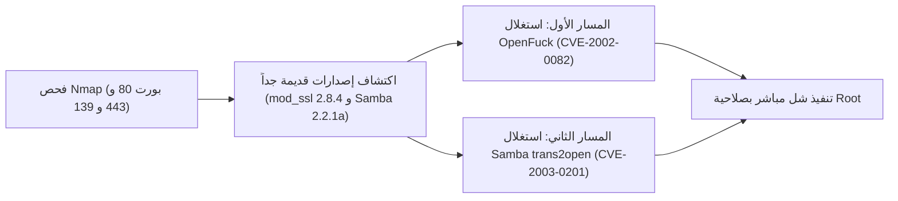

# Kioptrix Level 1 — تقرير اختبار الاختراق الشامل

[English Version](README.md) | [📖 قراءة التقرير بالعربية](README_AR.md)
[📄 تحميل التقرير الأصلي بصيغة PDF](./Kioptrix_1_Detailed_Writeup.pdf)

---

## 📋 بطاقة الهدف والمعلومات العامة

| العنصر | التفاصيل |
| :--- | :--- |
| **اسم الماشين** | Kioptrix Level 1 (منصة VulnHub) |
| **مستوى الصعوبة** | سهل (Easy) |
| **نوع التقييم** | فحص ثغرات الخدمات الشبكية في لينكس الكلاسيكي |
| **أبرز الثغرات** | طفح الذاكرة في mod_ssl (`CVE-2002-0082`)، طفح الذاكرة في Samba (`CVE-2003-0201`) |
| **نظام التشغيل** | Red Hat Linux 7.2 |
| **النتيجة** | الحصول المباشر على صلاحيات الجذر (Root) |

---

## 🎯 مسار الهجوم



---

## 🛠️ خطوات الهجوم العملية
1. **فحص الخدمات:** أظهر الفحص وجود خادم Apache 1.3.20 مع `mod_ssl 2.8.4` على المنفذ 443، وخادم `Samba 2.2.1a` على المنفذ 139.
2. **استغلال ثغرة OpenFuck:** الثغرة تؤدي إلى طفح في الذاكرة (Buffer Overflow) في معالجة اتصالات SSL. قمنا بتجميع الكود بلغة C وتشغيله:
   ```bash
   ./OpenFuck 0x6b <TARGET_IP> 443 -c 40
   ```
   يمنح الاستغلال وصولاً فورياً بصلاحيات `root`.
3. **المسار البديل (Samba):** يمكن استغلال ثغرة `trans2open` عبر ميتاسبلويت للحصول على Root مباشرة.
