# Matrix 1 — Penetration Testing Report

[📖 قراءة التقرير بالعربية](README_AR.md) | [English Version](README.md)
[📄 Original Report File (PDF)](./تقرير%20فحص%20أمني%20-%20Matrix%201.pdf)

---

## 📋 Overview & Metadata

| Attribute | Details |
| :--- | :--- |
| **Target Machine** | Matrix 1 (VulnHub) |
| **Difficulty** | Intermediate |
| **Assessment Type** | Black-box Penetration Test |
| **Prepared By** | Ebrahim Hesham (Helwan International Technological University) |
| **Key Concepts** | Source Code Inspection, Obfuscation & Brainfuck Cipher Decoding, Web Steganography, Rabbit Hole Avoidance, SUID / Sudo Privilege Escalation |
| **Result** | Full System Compromise & Root Flag Captured |

---

## 🎯 Attack Chain

```mermaid
graph LR
    A["Nmap Scan (Port 22 SSH, 80 HTTP)"] --> B["Inspect Web Page Source & Comments"]
    B --> C["Filter Out Rabbit Holes"]
    C --> D["Locate Brainfuck Encoded Ciphertext"]
    D --> E["Decode Cipher -> Credentials / Private Key"]
    E --> F["Initial Shell on System"]
    F --> G["Local Enumeration (Cron / SUID / Sudo)"]
    G --> H["Root Escalation -> Root Flag Captured"]
```

---

## 🛠️ Step-by-Step Walkthrough

### Phase 1: Reconnaissance
Scanning shows open ports:
* `22/tcp` — OpenSSH
* `80/tcp` — Apache HTTP Server

### Phase 2: Web Enumeration & Brainfuck Decryption
1. Visiting the web page displays Matrix-themed graphics. Inspecting HTML source code reveals extensive commented lines.
2. Several dummy hints and rabbit-holes are placed to divert the tester.
3. Filtering and extracting meaningful encrypted blocks reveals a string formatted in **Brainfuck** esoteric programming language (composed of `+`, `-`, `<`, `>`, `[`, `]`, `.`).
4. Decoding the Brainfuck string using an online or offline interpreter outputs credentials / access strings for the system.

### Phase 3: Exploitation & Root Privilege Escalation
1. Utilizing the extracted credentials to authenticate via SSH or through a hidden web parameter.
2. Once on the target system, perform standard local Linux enumeration.
3. Identify SUID binaries or sudo misconfigurations allowing command execution as the superuser.
4. Elevate privileges to `root` and read the victory flag!
