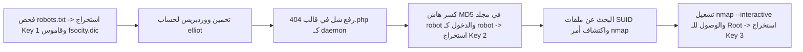

# Mr. Robot — تقرير اختبار الاختراق التفصيلي الشامل

[English Version](README.md) | [📖 قراءة التقرير بالعربية](README_AR.md)
[📄 تحميل التقرير الأصلي بصيغة DOCX](./Mr_Robot_Full_PenTest_Report.docx)

---

## 📋 بطاقة الهدف والمعلومات العامة

| العنصر | التفاصيل |
| :--- | :--- |
| **اسم الماشين** | Mr. Robot Vulnerable VM (منصة VulnHub / TryHackMe) |
| **آي بي الهدف** | `10.10.10.132` |
| **آي بي المهاجم** | `10.10.10.128` |
| **الأهداف** | اختراق السيرفر بالكامل واستخراج الأعلام الثلاثة (3 Keys) |
| **المفاهيم الأساسية** | استطلاع `robots.txt`، تخمين لوحة ووردبريس، كسر تشفير MD5، تصعيد الصلاحيات بـ SUID Nmap |

---

## 🎯 مسار الهجوم والأعلام الثلاثة (Attack Chain)



---

## 🛠️ الخطوات العملية بالتفصيل

### 1. استخراج العلم الأول (Key 1)
* بالدخول على `http://10.10.10.132/robots.txt`، عثرنا على ملفين:
  1. `key-1-of-3.txt`: يحتوي على **العلم الأول**.
  2. `fsocity.dic`: قاموس ضخم لكلمات المرور تم تنقيحه وترتيبه بحذف الكلمات المكررة (`sort -u`).

### 2. اختراق ووردبريس واستخراج العلم الثاني (Key 2)
* صفحة تسجيل الدخول `wp-login.php` كشفت أن اسم المستخدم الصحيح هو `elliot`.
* باستخدام القاموس `fsocity.dic` تم كسر كلمة السر وتسجيل الدخول.
* قمنا بتعديل قالب `404.php` وحقن شل عكسي واستقبال الاتصال كـ `daemon`.
* داخل مجلد `/home/robot`، عثرنا على ملف الهاش `password.raw-md5`.
* بفك تشفير الهاش، حصلنا على كلمة السر: `abcdefghijklmnopqrstuvwxyz`.
* تم التبديل للمستخدم `robot` وقراءة **العلم الثاني (Key 2)**.

### 3. تصعيد الصلاحيات للـ Root واستخراج العلم الثالث (Key 3)
* بالبحث عن الملفات التي تمتلك تصريح `SUID`:
```bash
find / -perm -u=s -type f 2>/dev/null
```
* تم العثور على أداة `/usr/local/bin/nmap` مفعلاً عليها SUID.
* إصدار Nmap القديم يحتوي على ميزة الوضع التفاعلي `--interactive` التي تتيح تشغيل شل نظام بأعلى صلاحية:
```bash
/usr/local/bin/nmap --interactive
nmap> !sh
whoami
root
```
* تمت قراءة **العلم الثالث والأخير (Key 3)** من مجلد `/root/key-3-of-3.txt`.
